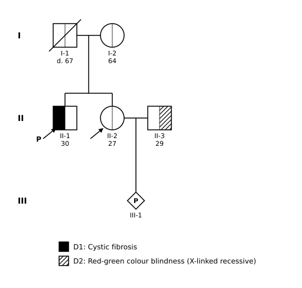

# pedkit

[](https://github.com/mkamil-turan/pedkit/actions/workflows/tests.yml)
[](LICENSE)

pedkit is a Python package for the pedigree problems of medical genetics teaching. It reads pedigrees in a small tab-separated format (PEDX), validates them with line-numbered findings, draws them with the NSGC standard symbols, infers the mode of inheritance, computes Bayes risk tables, and computes recurrence risks for multifactorial diseases under the liability-threshold model. Every computation prints its full working: the genotype configurations behind a likelihood, the prior, conditional, joint and posterior columns of a Bayes table, and two independent estimates of a multifactorial risk side by side.

<p align="center"></p>

## Features

- **PEDX format**: a superset of the PLINK/LINKAGE PED columns with named columns for NSGC drawing attributes and metadata lines for diseases and questions. Files are written back byte-identical; `.fam` export for PLINK.
- **Validation**: nine error and four warning rules, each reported with its line number.
- **Drawing**: NSGC symbols (Bennett et al. 2008, 2022) as dependency-free SVG 1.2 Tiny, PDF/PNG export and a PyQt5 viewer.
- **Mode-of-inheritance inference** over seven Mendelian modes (AD, AR, autosomal codominant, XD, XR, Y, MT): exact likelihoods by generalised Elston–Stewart peeling with no size limit, and Monte Carlo gene dropping that lists the genotype configurations and the individuals causing each conflict. Results are summarised in a hierarchical diagnosis tree.
- **Bayes risk**: the genetic-counselling table for carrier, affected, mutant, intermediate or genotype events, averaged over modes when the mode is unknown; exact fractions where they exist (2/3, 1/5, 1/153).
- **Multifactorial risk**: Falconer's liability-threshold model with sex-specific thresholds (Carter effect), computed both by peeling the hypergeometric polygenic model with Richardson extrapolation and by Gibbs-sampling MCMC, with five diagnostic plots.
- MZ twins share their genotype and polygenic value in every computation.

## Installation

```sh
pip install "pedkit[all]"
```

The core (reading, validation, SVG drawing) has no dependencies. The extras are `inference` (numpy), `mf` (numpy, matplotlib), `qt` (PyQt5) and `all`. PDF/PNG export and the viewer also need Qt's SVG module, which some Linux distributions ship as a separate package (`qt5-svg` on Arch, `libqt5svg5` on Debian/Ubuntu).

## Quick start

```sh
pedkit validate examples/cf_family.pedx
pedkit draw examples/cf_family.pedx -o family.svg
pedkit infer examples/cf_family.pedx
pedkit risk examples/dmd_bayes.pedx --individual II-2 --event carrier
pedkit risk examples/cf_family.pedx --questions
pedkit mf examples/multifactorial.pedx --individual III-2 --plots plots/
pedkit-view examples/multifactorial.pedx
```

The Bayes risk of the DMD textbook example (a sister of an affected boy with two healthy sons):

```
── XR · X-linked recessive ──
  Genotype                Prior         Conditional               Joint           Posterior  P(event|g)
  0/0                 1/2 (0.5)              0.9999                 0.5           4/5 (0.8)           0
  0/1                 1/2 (0.5)                0.25               0.125           1/5 (0.2)           1
  P(heterozygous carrier (0/1) | data, XR) = 1/5 (0.2)
```

From Python:

```python
from pedkit import read
from pedkit.inference import infer_mode_exact
from pedkit.risk import bayes_risk
from pedkit.mf import mf_risk

ped = read("examples/cf_family.pedx")
print(infer_mode_exact(ped).diagnosis.diagnosis)      # autosomal recessive
print(bayes_risk(ped, "II-2", "carrier").risk)         # 0.6666...

r = mf_risk(read("examples/multifactorial.pedx"), "III-2", seed=1)
print(r.es.risk, r.mcmc.risk, r.relative_risk)         # 0.0816 0.0818 16.3
```

## Documentation

- [User guide](docs/user_guide.md): every command, how to read its output, and what the results do and do not mean.
- [PEDX format specification](docs/format.md).
- [Validation](docs/validation.md): how the results were checked against hand derivations, a second exact algorithm, simulation and numerical integration, and the NSGC symbol checklist.

## Scope

pedkit is designed for teaching-scale pedigrees (three to five generations, up to a few dozen individuals) and for the assumptions of textbook pedigree problems: one biallelic locus in Hardy–Weinberg equilibrium, age-independent penetrance, and an additive liability model without shared environment. It is not a clinical risk tool; a risk used in real counselling needs each assumption checked for the disease concerned (user guide, section 12).

## Citation

If you use pedkit, please cite it using the metadata in [CITATION.cff](CITATION.cff).

## License

MIT; see [LICENSE](LICENSE).
