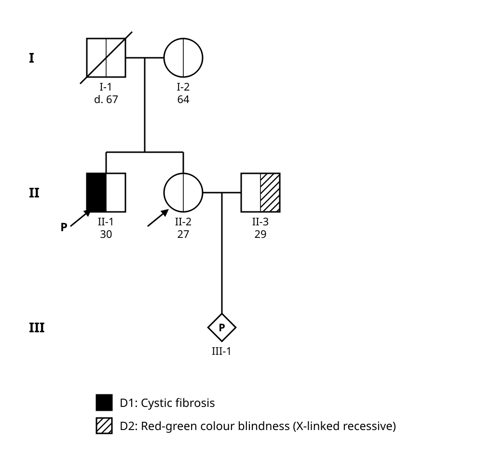
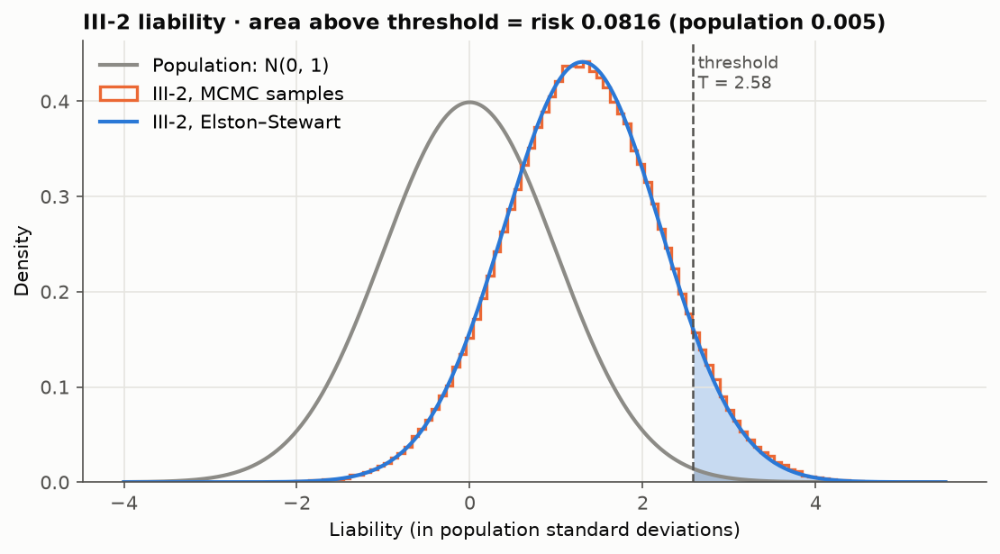
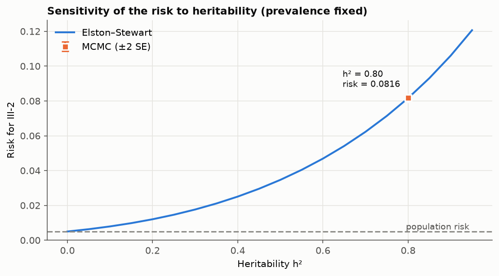
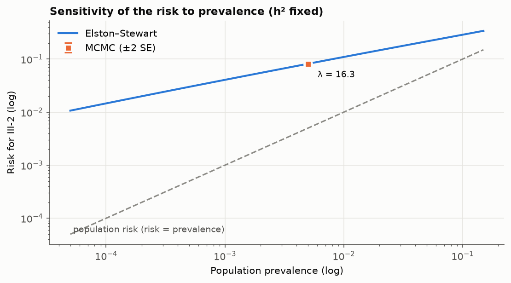
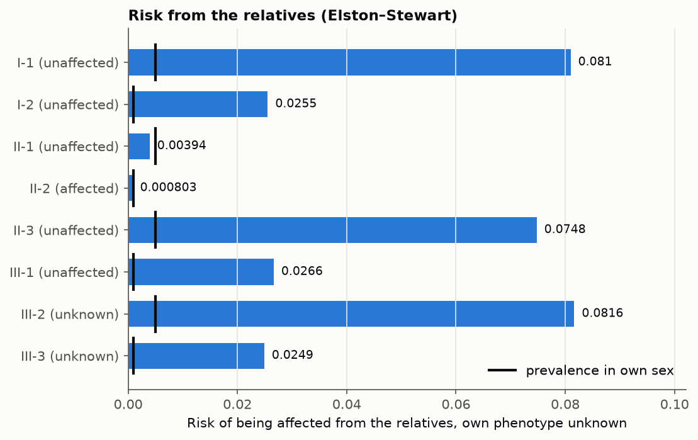
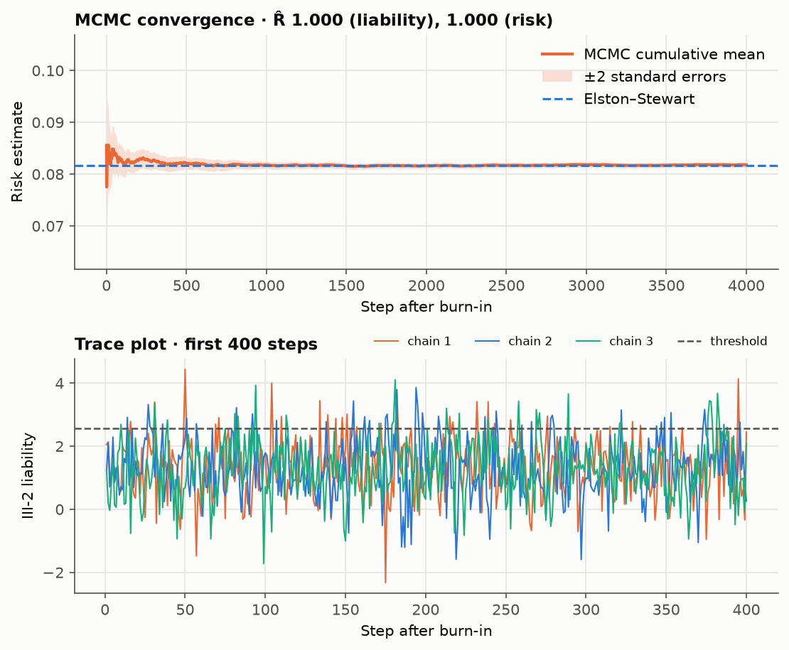

# pedkit kullanım kılavuzu

pedkit, PEDX biçiminde yazılmış bir soy ağacını okur, hatalarını denetler, NSGC sembolleriyle çizer, izlenen bir hastalığın kalıtım kalıbını kesin hesapla ya da Monte Carlo benzetimiyle değerlendirir, seçilen bir birey için Bayes riskini hesaplar ve multifaktöriyel hastalıklarda yatkınlık-eşik modeliyle tekrarlama riskini hesaplayıp grafiklerini çizer. Bu kılavuz önce aracın dayandığı literatürü anlatır. Ardından paketin her sınıfını tek tek ele alır: neden var olduğunu, ne iş yaptığını, ürettiği çıktının nasıl okunacağını ve neyi temsil etmediğini. Sonra hesaplarda kullanılan her formülü parametreleri ve yorumuyla verir, en sonda da her grafiği aynı düzende açıklar. Her yorum bölümünde sonucun ne anlama geldiği kadar ne anlama gelmediği de yazılıdır, çünkü bu tür araçların yanlış kullanımı çoğunlukla hesaptan değil yorumdan doğar.

Programın kendi çıktıları (raporlar, hata mesajları, grafik etiketleri) İngilizcedir; kılavuz bu çıktıları olduğu gibi gösterir ve Türkçe açıklar. Biçimin teknik belirtimi `docs/format.md`, doğrulama testlerinin listesi `docs/validation.md`, İngilizce kullanıcı kılavuzu `docs/user_guide.md` dosyasındadır.

## 1. Literatürün özeti

Kaynakça `references/pedigree_kaynakca.ris` dosyasındaki on yedi çalışmadan ve hesap yöntemlerinin dayandığı altı klasik makaleden oluşur. Bu bölüm onları pedkit'in tasarımına etkileri açısından gruplar.

### 1.1. Gösterim standardı

Bennett ve arkadaşlarının 2008 makalesi (Journal of Genetic Counseling 17:424–433), NSGC'nin 1995'te önerdiği soy ağacı sembollerinin sağlık meslekleri tarafından ne ölçüde benimsendiğini araştırır. Yazarlar PubMed'i, dergilerin yazar yönergelerini, meslek örgütlerinin sitelerini ve NSGC üyelerinin görüşlerini taradılar. Birçok dergi soy ağacı için belirli bir standart istemiyordu, ama standart belirtenlerin hepsi NSGC gösterimini gösteriyordu. 1995 gösterimine ciddi bir itiraz ya da rakip bir sistem bulunmadığı için makale yalnızca birkaç küçük biçimsel değişiklik önerir. Bugün kare-daire-eşkenar dörtgen, ölüm için çapraz çizgi, proband oku, ikizlerin tek noktadan ayrılması gibi kuralların kaynağı bu makaledir. pedkit'in çizim katmanı bu kuralları uygular (bölüm 5.4 ve 7.1).

Bennett ve arkadaşlarının 2022 revizyonu (Journal of Genetic Counseling 31:1238–1248) yeni sembol önermez; 2008'den bu yana yayımlanmış çalışmalarda temel bir alternatif bulunmadığını tespit eder ve iki noktayı değiştirir. Birincisi doğumda atanan cinsiyet ile toplumsal cinsiyetin ayrılmasıdır: sembolün şekli kişinin cinsiyet kimliğini gösterir, doğumda atanan cinsiyet (AFAB, AMAB gibi kısaltmalarla) sembolün altına yazılır. İkincisi taşıyıcılığın gösterimidir. Resesif bir hastalığın heterozigot taşıyıcısını sembolün ortasındaki noktayla göstermek önceki önerilerdeydi; revizyon, birçok resesif hastalıkta taşıyıcıların belirti gösterebildiğini, bir kişinin birden fazla hastalığın taşıyıcısı olabileceğini ve tek bir noktanın hangi hastalığı kastettiğini söyleyemediğini belirterek taşıyıcılığın sembolün altına yazıyla not edilmesini önerir. pedkit 0.1 bu iki noktada 2022 önerisinden ayrılır. Sembol şekli `sex` sütunundan gelir ve toplumsal cinsiyet `gender` sütunundan sembolün altına etiket olarak yazılır. Taşıyıcı noktası da hâlâ çizilir, ama yalnızca test edilmiş `0/1` genotipinde ve çok hastalıklı sembolde ilgili hastalığın bölmesinin içinde. Bu farklar `docs/validation.md` dosyasının NSGC tablosunda kayıtlıdır.

### 1.2. Çizim ve düzenleme yazılımları

Madeline 2.0 (Trager ve ark. 2007, Bioinformatics) bağlantı ve aile tabanlı ilişkilendirme çalışmaları için yazılmış, komut satırından çalışan bir C++ çizim motorudur. Akraba evliliği döngülerini mümkün olduğunca döngülü grafik olarak, çizgiler kesişmeden çizilemediğinde döngüsüz grafik olarak çizen karma bir algoritma kullanır ve SVG çıktısı verir. pedkit'in SVG çıktısı ve dosyadan etkileşimsiz çizim fikri bu çizgidedir; Madeline'ın yüzlerce kişilik ailelere yönelik yerleşim algoritması ise pedkit'te yoktur.

kinship2 (Sinnwell, Therneau ve Schaid 2014, Human Heredity) R'daki eski kinship paketinin yeniden düzenlenmiş halidir. Soy ağacı nesnesi, standarda uygun çizim, X kromozomu için akrabalık matrisi ve soy ağacını yapısını bozmadan budama işlevleri sunar. Pedixplorer (Le Nézet ve ark. 2025, Bioinformatics) kinship2'nin üzerine kurulmuş bir Bioconductor paketidir; S4 `Pedigree` nesnesi, büyük ve çok kuşaklı soy ağaçlarında sorgulama ve budama, yeniden yazılmış çizim işlevleri ve R bilmeyenler için bir Shiny uygulaması ekler. ggpedigree (Garrison 2026, Journal of Open Source Software) soy ağacını ggplot2 ve plotly ile çizer ve binlerce bireylik ailelere ölçeklenmeyi hedefler. kinship2 ve Pedixplorer akrabalık katsayısını da hesaplar; pedkit'teki `kinship_matrix` aynı klasik rekürsiyonu kullanır (formül F15).

pedigreejs (Carver ve ark. 2018, Bioinformatics) web uygulamalarına gömülebilen, JavaScript ile yazılmış hafif bir grafik soy ağacı düzenleyicisidir; standart gösterimi kullanır ve SVG üretir. QuickPed (Vigeland 2022, BMC Bioinformatics) karmaşık akraba evliliklerini destekleyen çevrimiçi bir çizim aracıdır; akrabalık, akraba evliliği ve özdeşlik katsayılarını hesaplar ve iki birey arasındaki ilişkiyi sözcüklerle tarif eden bir algoritma içerir. Hedef kitlesi arasında öğretmenler de sayılır. genoDraw (Garcia-Giordano ve ark. 2020, AMIA) klinik kullanıcılar için web tabanlı bir araçtır; çizimi üç adımlı grafik tabanlı bir süreçle üretir ve bireylerin bilgilerini biyomedikal terminolojilerle eşler. Genetic ME (Bui ve ark. 2015, BMC Research Notes) aynı büyük ailenin farklı aile üyelerinden toplanmış soy ağaçlarını karşılaştırıp birleştiren, her değişikliğin kaynağını izleyen bir Java uygulamasıdır.

Bu araçların ortak noktası soy ağacını kaydetmek, düzenlemek ve çizmektir. Hiçbiri kalıtım kalıbını sınamaz ya da danışmanlıktaki Bayes tablosunu kurmaz. pedkit'in çizim tarafı bunlarla aynı işi daha küçük ölçekte yapar; ayrıldığı yer hesap tarafıdır.

### 1.3. Soy ağacından risk hesaplayan klinik araçlar

CanRisk (Carver ve ark. 2020, Cancer Epidemiology, Biomarkers & Prevention) BOADICEA meme ve over kanseri risk modelinin web arayüzüdür. Aile öyküsünü, kanser yatkınlık genlerindeki patojenik varyantları, poligenik risk skorlarını, yaşam tarzı, hormonal ve görüntüleme risk etmenlerini birlikte alır; kanser riskini ve belirli genlerde patojenik varyant taşıma olasılığını tahmin eder. Soy ağacı girişi için pedigreejs'i kullanır. Fam3PRO (Chen ve ark. 2026, JCO Clinical Cancer Informatics) çok genli ve çok kanserli bir Mendel risk modelidir; R paketi 22 geni ve bunlarla ilişkili 18 kanseri içerir, makale bu modele R Shiny ile yazılmış bir web arayüzü ekler. Bu iki araç gerçek hastalar için klinik karar verdirmek üzere tasarlanmıştır; hastalığa özgü, yaşa bağlı penetranslı modeller kullanırlar ve hesabın ara adımlarını kullanıcıya göstermezler. pedkit bunun tersini yapar: modeli basit tutar (iki alelli tek gen ya da tek eşikli yatkınlık) ve her ara sayıyı yazdırır. Bu yüzden klinik risk modellerinin yerine geçmez, onların arkasındaki mantığı öğretmeye yarar.

### 1.4. Veri biçimi

PLINK (Purcell ve ark. 2007, American Journal of Human Genetics) genom boyu ilişkilendirme çalışmaları için yazılmış açık kaynaklı bir C/C++ araç setidir; veri yönetimi, özet istatistikler, toplum tabakalanması, ilişkilendirme analizi ve kalıtımla özdeşlik (IBD) tahmini işlevleri vardır. İkinci kuşak PLINK (Chang ve ark. 2015, GigaScience) bit düzeyinde paralellik ve algoritmik iyileştirmelerle çoğu işlemi on ila on bin kat hızlandırır ve olasılıklı genotipleri, faz bilgisini ve çok alelli varyantları taşıyan yeni bir veri biçimi getirir. pedkit'in buradan aldığı tek şey PED/FAM biçiminin ilk altı sütunudur (aile, birey, baba, anne, cinsiyet, fenotip). PEDX bu altı sütunu aynen korur ve yanına adlandırılmış sütunlar ekler; böylece bir ders örneği kayıpsız olarak `.fam` dosyasına çevrilebilir.

### 1.5. Araştırmada soy ağacı

Baş ve arkadaşlarının 2026 çalışması (Medicina 62:1635), Ege Üniversitesi'nde izlenen on bir kalıtsal anjiyoödem (HAE-C1INH) probandının ailelerinden 295 bireylik soy ağaçları kurar. Hastalık SERPING1 genindeki mutasyonlarla ortaya çıkan, otozomal dominant bir hastalıktır. Belirtili 53 bireyin 7'si varyant için homozigottur; bu, akraba evliliğinin sık olduğu bir toplumda dominant bir hastalığın bile homozigotlarla karşılaşılabileceğini gösterir. Heterozigotlar arasında missense mutasyon taşıyanların C1-INH işlevsel etkinliği daha yüksek, hastalık başlangıç yaşı daha geç ve yıllık atak sayısı daha düşük bulunmuştur. Yazarlar, ailesel kümelenme ve az sayıda bağımsız aile nedeniyle bu bulguların genellenebilirliğinin sınırlı olduğunu yazar. pedkit açısından bu çalışma iki şeyi gösterir: gerçek ailelerde aynı genotip farklı şiddette hastalık verebilir (pedkit'in tek penetrans değeri bunu modellemez), ve akraba evliliği soy ağacında döngüler oluşturur (pedkit'in soyma algoritması döngüleri kesin olarak hesaplar).

Schote ve arkadaşlarının 2020 çalışması (PLoS ONE 15:e0244565) primer fokal hiperhidrozlu dokuz ailede (50 etkilenmiş, 53 etkilenmemiş birey) genom boyu parametrik bağlantı analizi yapar. Hastalık için daha önce eksik penetranslı otozomal dominant kalıtım ve değişken fenotip bildirilmişti. Çalışma dört bölgede genom boyu anlamlı LOD skoru bulur (1q41-1q42.3, 2p14-2p13.3, 2q21.2-2q23.3, 15q26.3), aileler farklı bölgelere bağlandığı için hastalığın genetik olarak heterojen olduğu sonucuna varır; tüm ekzom dizilemesi nedensel bir varyant göstermemiştir. Bu çalışma pedkit'in kapsamı dışındaki bir analizi (bağlantı analizi) temsil eder, ama eksik penetransın soy ağacı yorumunu nasıl değiştirdiğine gerçek bir örnektir: penetrans 1 varsayıldığında dominant kalıtımı dışlayan bir aile, penetrans 0.7 ile dominant kalıtımla uyumlu hale gelebilir (bölüm 5.7'deki yorum).

### 1.6. Eğitimde soy ağacı

Mohammed Kamal ve arkadaşlarının 2026 makalesi (Journal of Microbiology & Biology Education) giriş düzeyi biyoloji derslerinde soy ağacı problemlerinin fenotip çeşitliliğini "etkilenmiş/etkilenmemiş" ikiliğine ve kusursuz Mendel kalıtımına indirdiğini, fenotipin tamamen genotip tarafından belirlendiği varsayımını üstü kapalı olarak öğrettiğini savunur. Yazarlara göre Mendel ilkelerini çevreyi dışarıda bırakarak vurgulamak bugünkü genetik bilgisini yansıtmaz ve genetik özcülüğü pekiştirebilir. Önerdikleri ders, kırmızı renk körlüğünün (protanopi) klasik bir X'e bağlı soy ağacıyla başlar ve ardından bu ikili sınıflamanın arkasındaki karmaşıklığı öğrencilere buldurur; renk görme bozukluklarının toplumdaki birleşik yaygınlığı yaklaşık %2.6 olarak verilir. pedkit'in multifaktöriyel modülü bu eleştiriye bir yanıt olarak eklendi: aynı dosya biçiminde, aynı araçla hem Mendel kalıtımlı hem multifaktöriyel bir hastalık çalışılabilir ve multifaktöriyel raporda riskin kalıtsallığa ve prevalansa ne kadar duyarlı olduğu grafikle gösterilir. Örnek dosyadaki renk körlüğü (D2, `cf_family.pedx`) bilerek bu makaledeki klasik X'e bağlı varsayımla kodlanmıştır; derste makalenin tartışmasına giriş noktası olarak kullanılabilir.

### 1.7. Hesap yöntemlerinin kaynakları

Elston ve Stewart (1971, Human Heredity 21:523–542) bir soy ağacının olabilirliğini, çekirdek aileleri tek tek "soyarak" (peeling) üstel değil doğrusal maliyetle hesaplayan algoritmayı verdi. Cannings, Thompson ve Skolnick (1978, Advances in Applied Probability 10:26–61) bu yöntemi herhangi bir eleme sırasına ve döngülü soy ağaçlarına genelledi; pedkit'in `pedkit.peeling` modülü bu genellemenin bugünkü adıyla değişken elemesidir. Falconer (1965, Annals of Human Genetics 29:51–76) multifaktöriyel hastalıklar için yatkınlık-eşik modelini ve akrabalardaki sıklıktan kalıtsallık tahminini önerdi. Fernando, Stricker ve Elston (1994, Theoretical and Applied Genetics 88:573–580) sürekli poligenik bileşeni soyulabilir hale getiren hipergeometrik poligenik modeli verdi. Albert ve Chib (1993, Journal of the American Statistical Association 88:669–679) ikili gözlemleri gizli normal değişkenlerle tamamlayıp Gibbs örneklemesiyle çözen veri tamamlama yöntemini, Gelman ve Rubin (1992, Statistical Science 7:457–472) birden fazla zincirle yakınsamayı ölçen R̂ istatistiğini tanımladı. Bu kaynakların her birinin pedkit'teki karşılığı bölüm 6'daki formüllerde gösterilmiştir.

### 1.8. Literatürden çıkan boşluk

Çizim araçları (1.2) hesap yapmaz, risk araçları (1.3) hesabı gizler ve belirli kanserlerle sınırlıdır, eğitim literatürü (1.6) ise Mendel dışı kalıtımın derslerde eksik kaldığını söyler. pedkit bu üçünün arasındaki işi yapmak için yazıldı: standart sembollerle çizen, yedi Mendel kalıbını ve multifaktöriyel modeli aynı çerçevede hesaplayan ve her ara sayıyı gösteren, bir öğrencinin dizüstü bilgisayarına kurulabilecek kadar küçük bir araç. Klinik risk modeli, bağlantı analizi programı ya da büyük soy ağacı çizim motoru değildir.

## 2. Kurulum ve çalışma ortamı

pedkit Python 3.10 ve üstünü ister. Okuma, yazma, doğrulama ve SVG çizimi yalnızca standart kütüphaneyle çalışır. Diğer işlevler isteğe bağlı paketlere ihtiyaç duyar: kalıp çıkarımı ve Bayes riski numpy, multifaktöriyel risk ve grafikleri numpy ile matplotlib, görüntüleyici penceresi ve PDF/PNG çıktısı PyQt5 ister. Kaynak klasöründen geliştirme kurulumu şöyle yapılır:

```fish
cd ~/Projects/PyDigree
python -m venv .venv
.venv/bin/pip install -e ".[all,test]"
```

Arch Linux'ta Qt'nin SVG modülü pip ile gelmez, sistem paketi olarak kurulur: `sudo pacman -S qt5-svg`. Görüntüleyici `Could not load PyQt5/QtSvg` mesajı verirse eksik olan budur.

Bütün komutlar sanal ortamdaki Python ile çalıştırılmalıdır. Fish kabuğunda ortam bir kez `source .venv/bin/activate.fish` ile etkinleştirilirse sonraki komutlar doğrudan `pedkit ...` diye yazılabilir; etkinleştirilmezse `.venv/bin/pedkit ...` ya da `.venv/bin/python -m pedkit ...` kullanılır. Sistemin kendi Python'u numpy'yi görmez ve `ModuleNotFoundError` verir. Kurulumun çalıştığını görmenin en hızlı yolu testlerdir: `python -m pytest -q` komutu `90 passed` satırıyla bitmelidir.

Proje klasöründe `pedkit/` paketin kendisidir, `examples/` bu kılavuzdaki bütün örneklerin girdisi olan `.pedx` dosyalarını, `tests/` otomatik testleri, `docs/` belgeleri ve grafik örneklerini, `paper/` JOSS makalesi taslağını içerir.

## 3. PEDX dosyası

PEDX dosyası UTF-8 kodlamalı, sekmeyle ayrılmış düz metindir. Üç bölümü vardır: `##` ile başlayan üst veri satırları, `#` ile başlayan tek bir sütun başlığı ve her biri bir bireyi tanımlayan veri satırları. Sütunlar arasında boşluk değil sekme (Tab) karakteri olmalıdır; düzenleyiciniz sekmeyi boşluğa çeviriyorsa doğrulama `E8` hatası verir. Kılavuzun büyük kısmında kullanılan `examples/cf_family.pedx` şöyledir:

```
##format=PEDX/0.1
##family=<ID=FAM01,description="Teaching example: cystic fibrosis and colour blindness in one family">
##disease=<ID=D1,name="Cystic fibrosis",mode=unknown,allele_freq=0.02,penetrance=1.0,mutation_rate=0,pattern=solid>
##disease=<ID=D2,name="Red-green colour blindness",mode=XR,allele_freq=0.08,penetrance=1.0,pattern=hatched>
##union=<p1=II-2,p2=II-3,consanguinity=none,status=married>
##question=<ID=Q1,type=mode,disease=D1>
##question=<ID=Q2,type=risk,individual=II-2,disease=D1,event=carrier>
##question=<ID=Q3,type=risk,individual=III-1,disease=D1,event=affected>
#family	individual	father	mother	sex	D1	D2	G:D1	G:D2	role	deceased	age	kind	order
FAM01	I-1	0	0	1	1	1	.	.	.	1	67	birth	1
FAM01	I-2	0	0	2	1	1	.	.	.	0	64	birth	2
FAM01	II-1	I-1	I-2	1	2	1	1/1	.	P	0	30	birth	1
FAM01	II-2	I-1	I-2	2	1	1	.	.	C	0	27	birth	2
FAM01	II-3	0	0	1	1	2	.	1	.	0	29	birth	3
FAM01	III-1	II-3	II-2	0	0	0	.	.	.	0	.	planned	1
```

İlk satır her zaman `##format=PEDX/0.1` olmalıdır. Her `##disease` satırı bir hastalık tanımlar ve dosyadaki ilk hastalık birincil hastalıktır; komutlarda hastalık belirtilmezse o kullanılır. Hastalık satırındaki alanlar hesapları doğrudan belirler. `allele_freq` toplumdaki hastalık aleli frekansı q'dur, yazılmazsa 0.01 kabul edilir. `penetrance` hastalık genotipini taşıyan birinin hasta olma olasılığıdır (varsayılan 1). `phenocopy` hastalık genotipi olmayan birinin hasta görünme olasılığıdır, `mutation_rate` kuşak başına aktarılan alelde normalden hastalık aleline yeni mutasyon oranıdır; ikisinin de varsayılanı 0'dır. `mode` alanı `AD`, `AR`, `ACD` (otozomal kodominant), `XD`, `XR`, `Y`, `MT`, `MF` (multifaktöriyel) ya da `unknown` olabilir. Kalıp çıkarımı bu alana bakmaz, çünkü bütün kalıpları dener; Bayes riski ise kalıp yazılmışsa yalnızca onu, `unknown` ise bütün kalıpları kullanır. Multifaktöriyel hastalıkta `prevalence` (ya da cinsiyete özgü `prevalence_male` ve `prevalence_female`) ile `heritability` alanları gerekir. `pattern` çizimde etkilenmiş sembolün dolgusudur: `solid`, `hatched`, `dotted` ya da `quadrant`.

İlk beş sütun sabittir: `family`, `individual`, `father`, `mother`, `sex`. Altıncı sütun birincil hastalığın fenotip sütunudur ve adı hastalık kimliğiyle aynıdır. Diğer sütunlar adlarıyla tanınır ve herhangi bir sırada olabilir; tanınmayan sütunlar (örneğin kendi notlarınız) saklanır ve dosya yeniden yazıldığında korunur. Ebeveyn sütunlarında ebeveynin kimliği ya da `0` bulunur. `sex` 1 erkek, 2 kadın, 0 bilinmiyor demektir. Fenotip sütunlarında 1 etkilenmemiş, 2 etkilenmiş, 3 ara fenotip (yalnızca kodominant hastalıkta, heterozigotun kendine özgü ifadesi), 0 bilinmiyor anlamındadır. `G:` önekli sütunlar test edilmiş genotiptir: `0/0`, `0/1`, `1/1`; X'e bağlı hastalıkta erkek için ve `Y`, `MT` kalıplarında tek alelli `0` ya da `1`; test yoksa `.`. Heterozigot her zaman `0/1` yazılır, `1/0` kabul edilmez. `role` sütununda `P` proband, `C` danışan (consultand) demektir. `kind` sütunu `birth`, `planned`, `pregnancy`, `miscarriage` ya da `stillbirth` olabilir. `twin` sütununa `MZ:a`, `DZ:a` ya da `?:a` yazılır; aynı harfi taşıyan kardeşler aynı ikiz grubundadır. `adopted` sütunu `in` ya da `out`, `order` kardeşlerin soldan sağa sırası, `gender` sembolün altına yazılacak toplumsal cinsiyet etiketidir.

`##union` satırı yalnızca dosyadan çıkarılamayan bir eş ilişkisi için gerekir: çocuksuz bir evlilik, ayrılık ya da ortak atası dosyada olmayan bir akraba evliliği. `##question` satırları `--questions` seçeneğiyle yanıtlanacak soruları kaydeder; `type=mode` kalıp sorusu, `type=risk` risk sorusudur.

## 4. Paketin yapısı

Paket, her biri bir öncekinin üzerine kurulan katmanlardan oluşur. Alttaki katmanlar yalnızca standart kütüphaneyi kullanır, üsttekiler isteğe bağlı paketlere ihtiyaç duyar. Böylece numpy kurulu olmayan bir bilgisayarda bile dosyalar okunup doğrulanabilir ve çizilebilir.

| Modül | Görevi | Ek paket |
|---|---|---|
| `pedkit.model` | Veri sınıfları: `Pedigree`, `Individual`, `Disease`, `Genotype`, `Union`, `Question`, `Finding` ve sabit değer kümeleri | yok |
| `pedkit.io` | PEDX okuma ve kayıpsız yazma, PLINK `.fam` aktarımı | yok |
| `pedkit.validate` | 9 hata ve 4 uyarı kuralı | yok |
| `pedkit.vis` | Yerleşim (`Layout`), SVG çizimi, PDF/PNG dışa aktarım, görüntüleyici penceresi | PDF/PNG ve pencere için PyQt5 |
| `pedkit.peeling` | Genelleştirilmiş Elston–Stewart soyması (`Factor`, `eliminate`) | numpy |
| `pedkit.inference` | Yedi Mendel kalıbının olabilirliği: kesin soyma, sayım, Monte Carlo; hiyerarşik tanı | numpy |
| `pedkit.risk` | Bayes risk tablosu ve dosyadaki soruların yanıtlanması | numpy |
| `pedkit.mf` | Yatkınlık-eşik modeli: Elston–Stewart (HPM) ve MCMC, grafikler | numpy, matplotlib |
| `pedkit.cli` | `pedkit validate|draw|fam|infer|risk|mf` komutları | |

Komut satırındaki her komut bu katmanlardan bir sınıf üretir ve o sınıfın `report()` yöntemini yazdırır. Bu yüzden bölüm 5'te sınıflar, ürettikleri raporla birlikte anlatılır.

## 5. Sınıflar

Her alt bölüm aynı sırayı izler: sınıfın neden var olduğu, ne iş yaptığı, çıktısının nasıl okunacağı ve neyi temsil etmediği. Formüllere F1, F2 gibi numaralarla atıf yapılır; formüllerin kendisi bölüm 6'dadır.

### 5.1. Pedigree ve kayıt sınıfları (`pedkit.model`)

`Pedigree` bir PEDX dosyasının bellekteki karşılığıdır ve diğer bütün sınıfların girdisidir. Ayrı bir sınıf olarak var olmasının nedeni, dosyanın biçimiyle hesapların ihtiyacını birbirinden ayırmaktır: dosya satır satır metindir, hesaplar ise "bu bireyin annesi kim, çocukları kimler, bu hastalıkta fenotipi ne" sorularını sorar. `Pedigree` bu soruları yanıtlayan yöntemleri taşır: `individual(id)` bir bireyi, `parents`, `children`, `spouses` akrabaları, `sibships` kardeş gruplarını, `ancestors` bir bireyin bütün atalarını, `mz_groups` tek yumurta ikiz gruplarını, `primary_disease` birincil hastalığı döndürür.

Kayıtlar ayrı sınıflardadır. `Individual` bir veri satırıdır: kimlik, ebeveynler, cinsiyet, her hastalık için fenotip ve test edilmiş genotip, rol, ölüm, yaş, doğum türü, ikizlik, evlat edinme, sıra ve toplumsal cinsiyet; tanınmayan sütunlar `extra` sözlüğünde durur. `founder` özelliği, ebeveyni dosyada olmayan (kurucu) bireyleri ayırır; hesaplarda kurucuların alelleri toplumdan çekilir (F1). `Disease` bir `##disease` satırıdır ve hesap parametrelerini taşır: q, penetrans, fenokopi, mutasyon oranı, kalıp, desen ve multifaktöriyel model için prevalans ve kalıtsallık. `Genotype` test edilmiş bir genotiptir; `biallelic` iki alelli olup olmadığını, `mutant_count` hastalık aleli sayısını, `heterozygous` heterozigotluğu söyler. `Union` bir `##union` satırıdır, `Question` bir `##question` satırıdır, `FamilyInfo` aile açıklamasıdır. `Source`, `FileSource` ve `MetaLine` hesaplara girmez; dosyanın yeniden yazılırken bayt bayt korunması için her kaydın hangi satırdan geldiğini ve satırın özgün metnini saklar.

Sabit değer kümeleri `Enum` sınıflarıdır: `Sex` (0, 1, 2), `Phenotype` (0 bilinmiyor, 1 etkilenmemiş, 2 etkilenmiş, 3 ara), `Mode` (AD, AR, ACD, XD, XR, Y, MT, MF, unknown), `Pattern`, `Kind`, `Role`, `TwinType`, `Adoption`, `Level` (ERROR, WARNING) ve `UnionStatus`. Bunların sınıf olarak tanımlanması, geçersiz bir değerin (örneğin cinsiyet 5) dosya okunurken yakalanmasını sağlar.

Bu sınıfların kendi çıktısı yoktur; Python'dan incelenirler (`ped.individual("II-2").phenotype("D1")` gibi). Bir `Pedigree` nesnesi, dosyanın biçim olarak okunabildiğini gösterir ama doğru olduğunu göstermez. Okuma sırasında bulunan sözdizimi sorunları nesneye eklenir ve ancak `validate()` çağrıldığında bulgu olarak listelenir. Nesne bir genetik model de değildir: alel frekansı, penetrans gibi değerler yalnızca saklanır, kullanılmaları hesap katmanlarına bırakılır.

### 5.2. Okuma ve yazma (`pedkit.io`)

`read(yol)` ve `read_text(metin)` bir PEDX dosyasını `Pedigree` nesnesine çevirir. İşi iç sınıf `_Parser` yapar: önce `##format` satırını, sonra üst veri satırlarını, sonra başlığı, en son veri satırlarını okur ve her hücreyi sütunun türüne göre ayrıştırır. Okuyucu ilk hatada durmaz. Okunamayan bir hücre (geçersiz cinsiyet, yanlış genotip yazımı, eksik hücre) bir `Finding` olarak kaydedilir ve okuma sürer; böylece bozuk bir dosyada bile bütün sorunlar tek seferde görülür.

`write(ped, yol)` ve `write_text(ped)` nesneyi tekrar PEDX'e çevirir. Tasarımın ana kuralı kayıpsızlıktır: okunup hiç değiştirilmeden yazılan bir dosya bayt bayt aynıdır. Sütun sırası, tanınmayan sütunlar, tanınmayan üst veri satırları, tırnaklar ve son satır sonu korunur; yalnızca değiştirilen kayıtların satırları yeniden üretilir. Bu kural, dosyanın hem elle hem programla düzenlenebilmesi için gereklidir. Bir öğretmen dosyaya kendi not sütununu eklediğinde program onu silmez.

`write_fam(ped, yol, disease)` ve `fam_text(ped, disease)` PLINK `.fam` dosyası yazar. Her satırda tam altı sütun vardır: aile, birey, baba, anne, cinsiyet, fenotip. Örneğin `pedkit fam examples/cf_family.pedx -o aile.fam --disease D2` komutunun çıktısında II-3'ün satırı `FAM01 II-3 0 0 1 2` olur (renk körü). Eksik fenotip PLINK'in `-9` değeriyle değil `0` ile yazılır. PLINK fenotipi ikili olduğu için ara fenotip (3) vaka, yani 2 olarak aktarılır; kodominant bir hastalıkta bu bir bilgi kaybıdır. Genotip sütunları, yaş, ölüm ve diğer alanlar `.fam` biçiminde yer almaz. Kimliklerinde boşluk olan bireyler aktarılamaz.

### 5.3. Finding ve doğrulama (`pedkit.validate`)

`Finding` tek bir doğrulama bulgusudur: düzey (`ERROR` ya da `WARNING`), kural kodu, dosyadaki satır numarası, ilgili birey ve açıklama. `validate(ped)` bütün kuralları uygular ve bulguları satır sırasıyla bir liste olarak döndürür; `errors(bulgular)` yalnızca hataları süzer. Hesap katmanları işe başlamadan önce `validate` çağırır ve hata varsa durur, çünkü örneğin bir döngü (biri kendi atası) olabilirlik hesabını anlamsız kılar.

```
pedkit validate examples/cf_family.pedx
6 individuals, 2 diseases · 0 errors, 0 warnings
```

Aşağıdaki çıktı aynı dosyanın üç satırı bilerek bozularak üretildi: I-1'in cinsiyeti 2 yapıldı, II-1'in babası `I-9` yazıldı, II-2'nin D1 değerine 5 girildi.

```
ERROR E5 (line 10) [I-1]: 'I-1' is female (sex=2) but is the father of: II-2.
ERROR E4 (line 12) [II-1]: 'I-9', given as father, is not in the file.
ERROR E8 (line 13) [II-2]: Invalid value '5' in column 'D1'; allowed: 0, 1, 2, 3.
6 individuals, 2 diseases · 3 errors, 0 warnings
```

Her satır düzey, kural kodu, satır numarası (düzenleyicinizin gösterdiği numara, ilk satır 1), köşeli parantezde birey ve açıklama sırasıyla okunur. Komut en az bir hata varsa 1, yoksa 0 çıkış koduyla biter.

| Kod | Düzey | Koşul |
|---|---|---|
| E1 | hata | İlk satır `##format=PEDX/...` değil ya da sütun başlığı yok. |
| E2 | hata | Zorunlu sütun eksik, ilk beş sütunun sırası yanlış, altıncı sütun birincil hastalık değil ya da bir sütun adı tekrarlanmış. |
| E3 | hata | Aynı ailede aynı birey kimliği iki kez kullanılmış. |
| E4 | hata | Baba, anne ya da `##union` dosyada olmayan bir bireye işaret ediyor. |
| E5 | hata | Baba kadın, anne erkek ya da aynı birey hem baba hem anne. Satır numarası ebeveynin kendi satırıdır. |
| E6 | hata | Soy ağacında döngü var: biri kendi atası. |
| E7 | hata | Bir hastalığın fenotip sütunu yok ya da bir `Dn`/`G:Dn` sütununun `##disease` tanımı yok. |
| E8 | hata | Değer izinli kümenin dışında, üst veri satırı bozuk, hücre sayısı yanlış ya da genotipin alel sayısı kalıba uymuyor. |
| E9 | hata | X'e bağlı bir hastalıkta erkeğe iki alelli genotip yazılmış. |
| W1 | uyarı | MZ ikizlerin cinsiyeti ya da test edilmiş genotipi farklı. |
| W2 | uyarı | Test edilmiş genotip, dosyadaki kalıp altında gözlenen fenotiple çelişiyor. |
| W3 | uyarı | Bir `##question` olmayan bir bireye ya da hastalığa işaret ediyor. |
| W4 | uyarı | Yalnızca bir ebeveyn verilmiş. |

W2 kuralı yalnızca kalıbı belirli bir Mendel kalıbı olan hastalıklarda çalışır. Kural, genotipin tam penetrans ve sıfır fenokopi altında hangi fenotipi vermesi gerektiğini hesaplar (`expected_phenotype`) ve gözlemle karşılaştırır (`contradicts_mode`). Penetrans 1'den küçükse hastalık genotipli sağlıklı bir birey, fenokopi 0'dan büyükse normal genotipli hasta bir birey çelişki sayılmaz, çünkü model bunları açıklayabilir. Örneğin AR bir hastalıkta `1/1` genotipli sağlıklı bir birey, penetrans 1 ise W2 verir, penetrans 0.9 ise vermez.

Hatasız bir doğrulama dosyanın biçim olarak doğru ve iç tutarlılığının yerinde olduğunu gösterir: herkesin ebeveyni dosyada vardır, cinsiyetler ebeveyn rolleriyle uyuşur, değerler izinli kümededir. Soy ağacının biyolojik olarak doğru girildiğini göstermez. Yanlış bireye etkilenmiş yazmak, kardeşlerin sırasını karıştırmak ya da alel frekansını yanlış girmek bir biçim kuralı ihlali değildir ve sonraki bütün hesaplara olduğu gibi taşınır. W4 uyarısı tek ebeveynli bireyi hatalı saymaz; hesaplarda eksik ebeveynin aktardığı alel toplumdan çekilir.

### 5.4. Layout, Sibship ve SVG çizimi (`pedkit.vis`)

Çizim iki aşamada yapılır ve her aşama ayrı bir sınıftır. `compute_layout(ped)` bir `Layout` nesnesi üretir: her bireyin kuşak numarasını ve yatay konumunu, her kardeş grubunu (`Sibship`: ebeveyn çifti ve çocukları) ve eş çiftlerini taşır. Kuşak, en uzun ata zincirinin uzunluğudur; aileye dışarıdan katılan eş, eşinin kuşağına yerleştirilir. Yatay konumlar çizgilerin kesişmemesi ve kardeşlerin ebeveynlerinin altında toplanması hedefiyle verilir; kardeşler `order` sütununa göre soldan sağa dizilir, dışarıdan katılan eş aileden gelen bireyin sağına konur. İkinci aşamada `draw(ped)` bu yerleşimden SVG metni üretir, `save(ped, yol)` uzantıya göre SVG, PDF ya da PNG yazar. Yerleşimin çizimden ayrılması, aynı yerleşimin hem SVG'de hem Qt penceresinde kullanılmasını sağlar.

SVG çıktısı bilerek SVG 1.2 Tiny özellikleriyle sınırlıdır: kırpma yolu (clipPath), desen (pattern) ve ok ucu (marker) kullanılmaz. Taralı ve noktalı dolgular, sembolün çokgeniyle kesilmiş çizgi ve daireler olarak hesaplanır (`pedkit.vis.geometry`). Bunun nedeni Qt'nin SVG motorunun yalnızca Tiny profilini desteklemesidir; aynı dosya tarayıcıda da Qt'de de aynı görünür. Tarayıcıda bir sembolün üzerine gelindiğinde o bireyin her hastalık için fenotipi ve test sonucu ipucu olarak görünür.

```fish
pedkit draw examples/cf_family.pedx -o soyagaci.svg
pedkit draw examples/cf_family.pedx -o soyagaci.pdf
pedkit-view examples/cf_family.pedx
```

`pedkit-view` görüntüleyici penceresini açar (`create_window`). Doğrulama bulguları terminale ve pencerenin alt çubuğuna yazılır. Dosyada `mode=MF` olan bir hastalık varsa pencere ikinci bir "Multifactorial risk" sekmesiyle açılır (`create_mf_panel`, bölüm 5.14). `File > Save as` (Ctrl+S) çizimi SVG, PDF ya da PNG olarak kaydeder.

Çizimin sembolleri bölüm 7.1'de grafik olarak açıklanır. Burada sınıfların neyi temsil etmediğini yazmak yeterli. Sembollerin yatay konumunun genetik bir anlamı yoktur; yalnızca `order` değerine ve yer kısıtlarına bağlıdır. Yerleşim 3-5 kuşaklık, 30 bireyden küçük ders soy ağaçları için tasarlandı; birden fazla kez evlenmiş bireylerde ya da evlilikle birleşen iki büyük soy ağacında bir eş çizgisi başka bir sembolün arkasından geçebilir. Madeline gibi büyük soy ağaçları için yazılmış bir yerleşim algoritması değildir.

### 5.5. Prepared (`pedkit.inference.prepare`)

`Prepared`, `Pedigree` nesnesinin hesaba hazırlanmış düz halidir. Neden ayrı bir sınıf olduğu basittir: `Pedigree` kimliklerle (dizgelerle) çalışır, hesap motorları ise binlerce kez "i numaralı bireyin annesi kaç numara" diye sorar ve bunun dizinlerle yapılması gerekir. `prepare(ped, disease)` önce doğrulamayı çalıştırır, hata varsa durur; sonra seçilen hastalığın parametrelerini (q, penetrans, fenokopi, mutasyon oranı) alır, her bireye bir dizin verir, anne ve baba dizinlerini (`-1` yok demek), cinsiyetleri, fenotipleri ve test edilmiş genotiplerin kodlarını listeler. Bireyleri ebeveynler çocuklardan önce gelecek biçimde sıralar (`order`) ve her MZ ikizi, sırada önce gelen eşine bağlar (`mz`). Bu son alan, MZ ikizlerin bütün motorlarda tek bir genotip paylaşmasını sağlar.

Kullanıcı bu sınıfı doğrudan görmez; raporlarda gördüğü birey adları (`labels`) bu sınıftan gelir. Birden fazla aileli bir dosyada adlar `AILE/BIREY` biçimini alır. `Prepared` bir sonuç değildir ve hiçbir olasılık içermez; yalnızca verinin hesaba uygun düzenidir. Alel frekansı yazılmamış bir hastalıkta q burada 0.01'e ayarlanır ve raporun başında görünen q değeri buradan gelir.

### 5.6. Factor ve eliminate (`pedkit.peeling`)

Bir soy ağacının olabilirliği, bütün bireylerin bütün olası genotipleri üzerinden alınan bir toplamdır (F4). Birey sayısı arttıkça olası genotip atamalarının sayısı üstel büyür: iki alelli bir otozomal gende her birey 4 sıralı durum alır ve 14 bireyde atama sayısı 4¹⁴ ≈ 270 milyondur. `pedkit.peeling` bu toplamı Elston–Stewart soymasının genelleştirilmiş haliyle (değişken elemesi) hesaplar ve bu yüzden paketin en temel hesap modülüdür. Hem Mendel kalıpları hem multifaktöriyel model aynı kodu kullanır.

`Factor` birkaç değişkene bağlı bir olasılık tablosudur: bir kurucunun genotip önseli tek değişkenli, bir çocuğun ebeveynlerine göre aktarım olasılığı üç değişkenli, bir gözlemin olasılığı tek değişkenli bir tablodur. `eliminate(factors, keep)` her adımda, elendiğinde en küçük ara tabloyu üretecek değişkeni seçer, o değişkeni içeren tabloları çarpıp o değişken üzerinden toplar ve yerine tek bir yeni tablo koyar (F5). `keep` boşsa sonuç tek bir sayıdır, yani olabilirliktir; `keep` bir bireyi içeriyorsa sonuç o bireyin genotipleri üzerinde bir tablodur ve normalleştirildiğinde bireyin sonsal genotip dağılımını verir. Sayısal taşmayı önlemek için her ara tablo en büyük değerine bölünür ve ölçek logaritma olarak ayrıca tutulur.

Bu modülün çıktısı doğrudan raporlanmaz; `P(data|mode)` sütunundaki kesin olabilirlikler, "Individual genotype probabilities" satırları, Bayes tablosunun önsel ve ortak sütunları ve multifaktöriyel Elston–Stewart riski bu fonksiyondan gelir. Döngüsüz bir soy ağacında elemenin maliyeti birey sayısıyla doğrusal artar; akraba evliliği döngüleri ara tabloları büyütür ama sonuç yine kesindir. Modül bir yaklaşım değildir, örnekleme hatası taşımaz; tek sınırı çok sık döngülü soy ağaçlarında ara tablonun 52'den fazla değişkene ulaşmasıdır ve bu durumda açık bir hata verir.

### 5.7. ModeInference, ModeResult, GenotypePool ve GenotypeConfiguration (`pedkit.inference`)

Kalıp çıkarımı şu soruyu yanıtlar: bu soy ağacındaki fenotip ve genotip gözlemleri, yedi Mendel kalıbından hangisiyle ne kadar uyumludur? Denenen kalıplar otozomal dominant (AD), otozomal resesif (AR), otozomal kodominant (ACD), X'e bağlı dominant (XD), X'e bağlı resesif (XR), Y'ye bağlı (Y) ve anneden geçen mitokondriyal (MT) kalıplardır. Her kalıbın aktarım kuralı `pedkit.inference.modes` modülündedir: otozomal kalıpta her ebeveyn iki kopyasından birini yarı yarıya olasılıkla verir; X'e bağlı kalıpta baba tek X'ini yalnızca kızlarına verir; Y'ye bağlı kalıpta Y yalnızca oğullara geçer; mitokondriyal kalıpta çocuk annesinin mitokondrisini alır, babanınkini hiç almaz.

Üç motor aynı genetik modeli değerlendirir. `infer_mode_exact` olabilirliği soymayla kesin hesaplar (varsayılan). `infer_mode` gen düşürme (gene dropping) ile Monte Carlo benzetimi yapar: kuruculara toplumdan rastgele aleller verir, bunları kalıbın kurallarıyla kuşaktan kuşağa aktarır ve her benzetimi gözlemlerle karşılaştırır; test edilmiş genotip birebir tutmalıdır, fenotip ise penetrans ve fenokopi olasılığıyla ağırlıklandırılır (F3, F6). Üçüncü motor `enumeration_likelihood` bütün genotip atamalarını tek tek sayar; 14 bireyle sınırlıdır ve yalnızca bağımsız denetim için vardır. Üç motor da bir `ModeInference` döndürür.

`ModeInference` bir hastalık için bütün kalıpların sonucunu toplar: `results` sözlüğü her kalıp için bir `ModeResult` içerir, `ranked` kalıpları sonsala göre sıralar, `most_likely` en olası kalıbı, `diagnosis` hiyerarşik tanıyı (bölüm 5.8), `report()` raporu verir. `ModeResult` tek bir kalıbın sonucudur: olabilirlik `P(data|mode)`, standart hatası, önsel, sonsal (F8), en olası kalıba göre Bayes faktörü, etkin örneklem büyüklüğü ve çelişki payları. `GenotypePool`, gözlemlerle uyumlu (destekleyen) ya da uyumsuz (desteklemeyen) benzetimlerin toplamıdır: kaç benzetim olduğu, oranı, önsel olasılığı (F10), en sık genotip yapılandırmaları ve her bireyin genotip dağılımı. `GenotypeConfiguration` ailenin bütün bireylerine birlikte atanmış tek bir genotip setidir.

```fish
pedkit infer examples/cf_family.pedx
pedkit infer examples/cf_family.pedx --method monte-carlo --seed 1
```

Raporun özet tablosu, `cf_family.pedx` için kesin hesapla şöyledir:

```
Mode-of-inheritance inference · D1 (Cystic fibrosis)
q=0.02 · penetrance=1 · phenocopy=0 · mutation rate=0 · exact computation (peeling)

Mode    Supporting  Frequency   P(data|mode)        ±SE   Prior  Posterior
AR               0          0       2.88e-04          0   0.143          1
AD               0          0              0          0   0.143          0
...
Posterior ranking: AR (1) > AD (0) > ACD (0) > XD (0) > XR (0) > Y (0) > MT (0)
```

Başlık satırı hesapta kullanılan parametreleri tekrarlar; burada beklemediğiniz bir değer görürseniz dosyanın `##disease` satırını kontrol edin. `P(data|mode)` olabilirliktir: kalıp doğruysa rastgele bir ailenin tam bu gözlemlerle ortaya çıkma olasılığı. AR için 2.88e-04, "AR'nin olasılığı on binde 2.88" demek değildir. Nadir bir hastalıkta etkilenmiş bir çocuk görmek zaten olası olmayan bir olaydır, bu yüzden olabilirlikler küçüktür; anlamlı olan kalıplar arasındaki oranlarıdır ve bunu `Posterior` sütunu gösterir. `Prior` her kalıba verilen önseldir (yedi kalıp için 1/7 ≈ 0.143). Kesin hesapta `Supporting` ve `Frequency` sütunları boştur, `±SE` sıfırdır.

Monte Carlo ile aynı tablo şöyle görünür:

```
q=0.02 · penetrance=1 · phenocopy=0 · mutation rate=0 · 1,000,000 simulations/mode

Mode    Supporting  Frequency   P(data|mode)        ±SE   Prior  Posterior
AR             300   3.00e-04       3.00e-04   1.73e-05   0.143          1
```

`Supporting` gözlemlerle uyumlu çıkan benzetim sayısıdır, `Frequency` bunun toplam benzetime oranıdır. `±SE` olabilirlik tahmininin standart hatasıdır (F6); tahmin gerçek değerden kabaca iki standart hata kadar sapabilir. Burada 3.00e-04 ± 1.73e-05 tahmini, kesin değer 2.88e-04'ten bir standart hatadan az uzaktadır. Penetrans 1 ve fenokopi 0 iken ve önem örneklemesi kapalıyken frekans ile olabilirlik aynıdır; eksik penetransta destekleyen benzetimler ağırlıklı sayıldığı için olabilirlik frekanstan küçük olur.

Her kalıp için ayrı bir bölüm de yazılır. Kesin hesapta bu bölüm kalıbın destekleyen havuzunun önsel olasılığını ve bireysel genotip olasılıklarını verir:

```
── AR ──
Supporting pool: prior probability 2.88e-04 (computed exactly)
  Individual genotype probabilities (given the observations):
    I-1      0/1: 1
    I-2      0/1: 1
    II-1     1/1: 1
    II-2     0/0: 0.333, 0/1: 0.667
    II-3     0/0: 0.961, 0/1: 0.039
    III-1    0/0: 0.654, 0/1: 0.34, 1/1: 6.5e-03
```

Bu tablo kalıbın ailedeki sonuçlarını en açık gösteren bölümdür. AR altında I-1 ve I-2 olasılık 1 ile `0/1`'dir: etkilenmiş bir çocuğu olan iki sağlıklı ebeveyn zorunlu taşıyıcıdır. II-2'nin taşıyıcılık olasılığı 2/3'tür, II-3'ünki toplumdaki sağlıklı bir bireyin taşıyıcılık olasılığı 2q/(1+q) = 0.039'dur, III-1'in `1/1` olma olasılığı 1/153'tür (bu sayıların türetilişi F11'dedir). Monte Carlo raporunda aynı satırlar havuzun örnekleme gürültüsünü taşır (II-2 için 0.69 gibi) ve üstlerinde en sık genotip yapılandırmaları listelenir:

```
Supporting pool: 300 simulations, 7 distinct configurations, effective sample 300
     0.34  (      102)  I-1=0/1 I-2=0/1 II-1=1/1 II-2=0/1 II-3=0/0 III-1=0/1
```

Bir yapılandırma satırındaki ilk sayı bu setin havuz içindeki olasılığı, parantezdeki sayı kaç benzetimde görüldüğüdür. `effective sample` ağırlıklı benzetimlerin kaç bağımsız benzetime denk geldiğidir (F7); birkaç yüzün altındaysa havuzdaki oranlar gürültülüdür. Desteklemeyen havuz bölümündeki "Individuals causing the conflict" satırı, desteklemeyen benzetimlerin ne kadarında o bireyin gözleminin açıklanamadığını gösterir:

```
  Individuals causing the conflict (share): II-1: 1, II-3: 4.2e-04, ...
```

Bu satır bir kalıbın neden elendiğini anlamak için en yararlı bilgidir. `cf_family.pedx`'te X, Y ve MT kalıplarında II-1'in payı 1'dir, çünkü II-1 erkektir ve `G:D1=1/1` iki alellidir; X'e bağlı bir gende erkeğin tek X'i vardır, bu test sonucu bu kalıplarla bağdaşmaz. Paylar toplamı 1'i aşabilir, çünkü bir benzetimde birden fazla birey aynı anda çelişebilir.

Kalıp çıkarımının sonucu dikkatle okunmalıdır. Sonsalın 1 çıkması kalıbın kesin doğru olduğunu söylemez; denenen yedi Mendel kalıbı arasında, dosyadaki q, penetrans, fenokopi ve mutasyon oranıyla yalnızca bu kalıbın gözlemleri açıklayabildiğini söyler. Gerçek kalıp bu yediden biri değilse araç bunu bilemez: imprinting, antisipasyon, iki genli kalıtım, yaşa bağlı penetrans ve heteroplazmi modellenmez, multifaktöriyel kalıp da sınanmaz. Parametreler sonucu değiştirir. AD burada sıfırdır, çünkü penetrans 1 ve mutasyon 0 iken iki sağlıklı ebeveynden etkilenmiş çocuk doğamaz; penetrans 0.8 ya da mutasyon oranı 0.001 yapılırsa AD artık sıfır olmaz. Tek bir test sonucu da bütün çıkarımı belirleyebilir: II-1'in `G:D1` hücresi `.` yapılırsa XR öne geçer, çünkü bir erkeğin taşıyıcı annesinden X'e bağlı hastalık alması (yaklaşık 2q), iki taşıyıcı ebeveynden resesif hastalık almasından (yaklaşık q²) çok daha olasıdır. Monte Carlo'da olabilirliğin 0 çıkması kalıbın dışlandığını değil, hiç uyumlu benzetim görülmediğini gösterir; `mitochondrial.pedx` örneğinde kesin hesap AR'ye 2.4e-09 verir, bir milyon benzetim 0 verir. Kesin dışlama için kesin hesaba bakılmalıdır. Son olarak, küçük bir aileden çıkan yüksek sonsal toplum düzeyinde bir kanıt değildir; klinik ya da yayın düzeyinde bir kalıp kararı birden fazla ailenin ve moleküler verinin birlikte değerlendirilmesini gerektirir.

### 5.8. HierarchicalDiagnosis ve DiagnosisNode (`pedkit.inference.diagnosis`)

Yedi kalıbın sonsalları bir öğrenci için doğrudan bir tanıya dönüşmez; derslerde soru genellikle iki adımda sorulur: önce kalıtım otozomal mi, gonozomal mı, mitokondriyal mi, sonra hangi alt kalıp. `HierarchicalDiagnosis` bu iki adımı bir ağaç olarak verir ve kalıp çıkarımı raporunun ilk bölümünü oluşturur. Ağacın her düğümü bir `DiagnosisNode`'dur: adı, olasılığı, üst düğüm içindeki payı, önseli ve alt düğümleri vardır (F9).

```
Hierarchical diagnosis

  Inheritance  (P = 1)
    ├─ Autosomal  (P = 1 · within parent 1 · prior 0.4286)
    │  ├─ autosomal dominant  (P = 0 · within parent 0 · prior 0.1429)
    │  ├─ autosomal recessive  (P = 1 · within parent 1 · prior 0.1429)
    │  └─ autosomal codominant  (P = 0 · within parent 0 · prior 0.1429)
    ├─ Gonosomal  (P = 0 · within parent 0 · prior 0.4286)
    │  ├─ X-linked  (P = 0 · within parent 0 · prior 0.2857)
    │  │  ├─ X-linked dominant  (P = 0 · within parent 0 · prior 0.1429)
    │  │  └─ X-linked recessive  (P = 0 · within parent 0 · prior 0.1429)
    │  └─ Y-linked  (P = 0 · within parent 0 · prior 0.1429)
    └─ Mitochondrial (maternal)  (P = 0 · within parent 0 · prior 0.1429)

  Level 1: Autosomal  (P = 1, within parent 1)
  Level 2: autosomal recessive  (P = 1, within parent 1)

Diagnosis: autosomal recessive
```

`P` dalın verilere göre doğru olma olasılığıdır ve altındaki kalıpların sonsallarının toplamıdır. `within parent`, üst dalın doğru olduğu kabul edildiğinde bu dalın payıdır: Gonosomal P = 0.5 ve X-linked P = 0.4 olsaydı X-linked için bu değer 0.8 olurdu ve "kalıtım gonozomalse X'e bağlı olma olasılığı 0.8" diye okunurdu. `prior` veri görülmeden önce dala verilen olasılıktır. `Diagnosis` satırı her düzeyde en olası dalı izleyerek bulunur ve bu seçimde eşik yoktur: bir dal 0.51, diğeri 0.49 olsa da tanı 0.51'lik dala konur. İki dal tam eşitse ikisi birden "(equally probable)" notuyla yazılır; hiçbir kalıp gözlemleri açıklayamıyorsa "no diagnosis" yazar.

Tanı satırı tek başına okunmamalıdır, ağaçtaki olasılıklarla birlikte okunmalıdır. Bir de önsellerin yan etkisi vardır: yedi kalıba eşit önsel verildiği için üç alt kalıplı Otozomal ve Gonozomal dallar 3/7 ile başlarken tek kalıplı Mitokondriyal dal 1/7 ile başlar. Veri güçlü olduğunda bu fark sonuca yansımaz; veri zayıfsa (az birey, az etkilenmiş, test yok) mitokondriyal dal baştan dezavantajlıdır. Hiyerarşik tanı bir karar kuralı değildir, sonsalların düzenlenmiş bir özetidir.

### 5.9. RiskResult, ModeRisk ve BayesRow (`pedkit.risk`)

Bayes riski, belirli bir bireyin belirli bir durumda olma olasılığıdır: taşıyıcı olması, hastalık aleli taşıması, etkilenmiş olması ya da belirli bir genotipte olması. Genetik danışmanlık bu olasılığı bir tabloyla hesaplar ve öğrenciler bu tabloyu elle kurmayı öğrenir. `bayes_risk(ped, birey, olay)` aynı tabloyu herhangi bir soy ağacı için kurar. Sınıfların neden üç katmanlı olduğu tablonun yapısından gelir: `BayesRow` tablonun bir satırıdır (bir genotip ve onun önsel, koşullu, ortak, sonsal değerleri ile o genotipte olayın olasılığı), `ModeRisk` bir kalıp altındaki tablonun tamamıdır (satırlar, kalıbın ağırlığı, olabilirliği ve o kalıp altındaki risk), `RiskResult` bütün kalıpların ağırlıklı sonucudur (birey, olay, yöntem, koşullu bilgiyi veren bireyler ve ortalama risk).

Hesap, verileri iki parçaya ayırır (F11). Koşullu bilgi, hedef bireyin torunlarının ve onların aileye dışarıdan katılmış ebeveynlerinin gözlemleridir; geri kalan her şey (bireyin kendi gözlemi, ataları, kardeşleri ve yan akrabaları) önsel bilgidir. Bu ayrım ders kitabındaki "etkilenmiş erkek kardeş, önsel 2/3; iki sağlıklı çocuk, koşullu (1/2)²" kalıbının genel halidir ve her soy ağacı için otomatik yapılır. Yöntem `exact` (soyma, boyut sınırı yok), `enumeration` (14 bireye kadar, bağımsız denetim) ya da `monte-carlo` olabilir; `auto` kesin hesabı seçer.

```fish
pedkit risk examples/dmd_bayes.pedx --individual II-2 --event carrier
```

```
Bayes risk · II-2 · D1 (Duchenne muscular dystrophy)
Event: heterozygous carrier (0/1) · method: exact
Prior information: the individual's own observations, ancestors and collateral relatives
Conditional information: II-3, III-1, III-2, III-3

── XR · X-linked recessive ──
  Genotype                Prior         Conditional               Joint           Posterior  P(event|g)
  0/0                 1/2 (0.5)              0.9999                 0.5           4/5 (0.8)           0
  0/1                 1/2 (0.5)                0.25               0.125           1/5 (0.2)           1
  P(heterozygous carrier (0/1) | data, XR) = 1/5 (0.2)

Bayes risk: P(heterozygous carrier (0/1)) = 1/5 (0.2)
```

`dmd_bayes.pedx` Duchenne kas distrofisi için yazılmış bir ders kitabı örneğidir: II-2'nin erkek kardeşi II-1 etkilenmiştir, II-2'nin iki sağlıklı oğlu (III-1, III-2) ve cinsiyeti bilinmeyen bir gebeliği (III-3) vardır. `Prior` sütunu 1/2'dir: II-1'in etkilenmiş olması anneleri I-2'yi zorunlu taşıyıcı yapar ve II-2 annesinin iki X'inden birini yarı yarıya olasılıkla almıştır. `Conditional` sütunu iki sağlıklı oğuldan gelir: II-2 taşıyıcıysa ikisinin birden sağlıklı olma olasılığı (1/2)² = 1/4, değilse 1'dir. `Joint` önsel ile koşullunun çarpımıdır, `Posterior` ortakların toplama bölünmesidir: (1/8)/(1/8 + 1/2) = 1/5. İki sağlıklı oğul, II-2'nin taşıyıcılık olasılığını 1/2'den 1/5'e indirmiştir. `0/0` satırındaki 0.9999 değeri koşullu bilgiye eş II-3'ün de girmesinden gelir: II-3'ün sağlıklı olma olasılığı 1 − q'dur, II-2'nin genotipinden bağımsızdır, iki satırda da aynıdır ve sonsalda sadeleşir. Ders kitapları bu terimi yazmaz; tabloda görünmesi, hangi bireyin koşullu bilgiye katıldığını gösterir. `P(event|g)` sütunu, o genotip doğruysa sorulan olayın olasılığıdır (F12); risk, sonsal ile bu sütunun çarpımlarının toplamıdır.

Kalıp dosyada `unknown` ise her kalıp için ayrı tablo kurulur ve rapor önce kalıp ağırlıklarını listeler (F13). `cf_family.pedx`'te II-2 için:

```
Mode weights P(mode | data):
  AR                        1   P(event | data, AR) = 2/3 (0.6667)
  AD                        0   P(event | data, AD) = —
```

Her satır bir kalıbın sonsal olasılığını ve o kalıp doğruysa bireyin riskini verir; `—` o kalıbın gözlemlerle bağdaşmadığını ve altında riskin tanımsız olduğunu gösterir. Değer basit bir kesre karşılık geliyorsa kesir parantezdeki ondalıkla birlikte yazılır; kesir yalnızca kesin hesapta gösterilir, çünkü 0.69 gibi bir Monte Carlo tahmini 69/100 diye tam bir orana sahip değildir.

Risk, verilen kalıp ve parametreler altında, dosyadaki bütün gözlemler hesaba katıldığında bireyin o durumda olma olasılığıdır. Kalıp, alel frekansı ya da penetrans yanlış girilmişse risk de yanlıştır. DMD örneğinde mutasyon oranı 0 girildiği için I-2 zorunlu taşıyıcıdır; gerçek DMD olgularının yaklaşık üçte biri yeni mutasyondur ve `mutation_rate` gerçekçi bir değer alırsa II-2'nin riski 1/5'in altına iner. Fenotipi gözlenmiş bir birey için "etkilenmiş" riski gözlemin kendisidir (1 ya da 0); yaşa bağlı penetrans modellenmediği için bugün sağlıklı birinin ileride hastalanma olasılığı hesaplanmaz. X'e bağlı bir hastalıkta erkek hemizigottur ve heterozigot olamaz; erkekte `carrier` olasılığı her zaman 0'dır, erkeğin aleli taşıyıp taşımadığı `--event mutant` ile sorulur. Cinsiyeti bilinmeyen bir gebelikte X'e bağlı risk cinsiyetin yarı yarıya olduğu varsayılarak hesaplanır: III-3 için `--event affected` sonucu 1/20'dir, yani "erkekse 1/10, kızsa 0" sonuçlarının ortalaması.

### 5.10. QuestionAnswer (`pedkit.risk.questions`)

Bir ödev ya da sınav sorusu genellikle aynı aile için birkaç soru içerir. `##question` satırları bu soruları dosyanın içinde saklar ve `answer_questions(ped)` hepsini sırayla yanıtlar. Her yanıt bir `QuestionAnswer` nesnesidir: soruyu, sonucu (bir `ModeInference`, `RiskResult` ya da `MFRiskResult`) ve yanıtlanamadıysa hata mesajını taşır. `type=mode` soruları için kalıp çıkarımı raporu, `type=risk` soruları için Bayes riski raporu yazılır; hastalık `mode=MF` ise risk sorusu multifaktöriyel modelle yanıtlanır.

```fish
pedkit risk examples/cf_family.pedx --questions
```

`cf_family.pedx` için Q1'in yanıtı otozomal resesif, Q2'nin (II-2 taşıyıcı) 2/3, Q3'ün (III-1 etkilenmiş) 1/153'tür. Bir soru yanıtlanamıyorsa (örneğin olmayan bir bireye işaret ediyorsa) nedeni yazılır ve diğer sorular yanıtlanmaya devam eder. Bu sınıf yeni bir hesap yapmaz; dosyadaki soruları bölüm 5.7, 5.9 ve 5.14'teki hesaplara yönlendirir.

### 5.11. MFParameters (`pedkit.mf.model`)

Yarık dudak, pilor stenozu, nöral tüp defekti ya da konjenital kalça çıkığı gibi hastalıklar tek bir genle değil, çok sayıda küçük etkili genin ve çevrenin toplamıyla ortaya çıkar. Bu hastalıklarda Mendel genotipi tanımlı olmadığı için Bayes tablosu kurulamaz; Falconer'ın yatkınlık-eşik modeli kullanılır (F14). `MFParameters` bu modelin parametrelerini taşır: prevalans K (cinsiyete özgüyse erkek ve kadın için ayrı) ve kalıtsallık h². Eşikleri de o hesaplar: `threshold`, `threshold_male`, `threshold_female` ve bir bireyin cinsiyetine göre `individual_threshold`. Cinsiyeti bilinmeyen bireye genel eşik verilir. `replace` yöntemi aynı parametrelerin bir değerini değiştirilmiş kopyasını üretir; duyarlılık grafikleri bunu kullanır.

`parameters(disease, ...)` nesneyi `##disease` satırındaki alanlardan kurar; komut satırından verilen değerler dosyadakini geçersiz kılar. h² = 1 kabul edilmez, çünkü modelde çevre varyansı 1 − h² sıfır olamaz; prevalans 0 ile 1 arasında olmalıdır. Raporun ilk satırları bu sınıfın içeriğidir:

```
Model: liability-threshold (Falconer) · h² = 0.8
  male: K = 0.005, threshold T = 2.576 · female: K = 0.001, T = 3.090
```

Kadınların eşiği erkeklerinkinden yüksektir, çünkü hastalık kadınlarda beş kat seyrektir. Parametreler bir tahmin değil girdidir; yayımlanmış h² değerleri aynı hastalık için çalışmadan çalışmaya değişir ve rapordaki risk ancak girilen parametreler doğruysa geçerlidir.

### 5.12. ESResult (`pedkit.mf.elston`)

Multifaktöriyel riskin ilk hesap yöntemi Elston–Stewart soymasıdır. Sorun şudur: sürekli bir yatkınlık doğrudan soyulamaz, çünkü genotip uzayı sonsuzdur. Hipergeometrik poligenik model (HPM) kalıtsal kısmı n lokuslu, eşit etkili alellerin toplamı olarak temsil eder (F16); bu durumda her bireyin "poligenotipi" 0 ile 2n arasında bir tamsayıdır ve aynı `eliminate` fonksiyonuyla soyulabilir. Sonlu n'de dağılımın kuyruğu normal kuyruktan incedir ve nadir bir hastalıkta risk tam bu kuyrukta belirlenir. Bu yüzden risk n ve 2n lokusla hesaplanır ve Richardson dışdeğerlemesiyle sonsuz lokus değerine taşınır (F17).

`ESResult` bu hesabın sonucudur: `risk` dışdeğerlenmiş risk, `risk_n` ve `risk_2n` iki ara sonuç, `posterior` hedefin poligenotip sonsal dağılımı (yatkınlık grafiğinde eğriye dönüşür, F22), `log_likelihood` gözlemlerin log-olabilirliği, `individual_risk` her bireyin kendi fenotipi bilinmeseydi akrabalarına göre taşıyacağı risk, `loci` n değeri.

```
  Elston–Stewart (HPM, Richardson n→∞): 0.0816
      n=20 loci: 0.0737 · n=40 loci: 0.0777
```

n=20 ve n=40 satırları dışdeğerlemenin girdileridir. İkisi arasındaki fark sonlu lokus hatasının büyüklüğünü gösterir; 2 × 0.0777 − 0.0737 ≈ 0.0817 hesabı bu hatanın birinci dereceden kısmını giderir (yuvarlamadan önceki değerlerle 0.0816). Bu sonuç bir örnekleme tahmini değildir, standart hatası yoktur; ama bir yaklaşımdır ve doğruluğu MCMC ile ve doğrudan çok değişkenli normal benzetimiyle karşılaştırılarak sınanmıştır (`docs/validation.md`). HPM'deki n, gerçek bir lokus sayısı değildir; yalnızca sürekli dağılıma yaklaşmanın hesap aracıdır.

### 5.13. MCMCResult (`pedkit.mf.mcmc`)

İkinci yöntem ilkinden bağımsızdır ve bu yüzden vardır: iki farklı yoldan aynı sayı çıkıyorsa ikisine de güvenmek için bir gerekçe olur. Sonsuz lokuslu modelde bireylerin yatkınlıkları, akrabalık matrisinden kurulan çok değişkenli normal dağılıma uyar (F15, F18). Gözlenen fenotipler bu dağılımı keser: etkilenmiş bireyin yatkınlığı eşiğin üstünde, etkilenmemişinki altında olmalıdır. `mcmc_risk` bu kesilmiş dağılımdan Gibbs örneklemesiyle örnek çeker (Albert ve Chib 1993): her adımda bir bireyin yatkınlığı, diğerleri verildiğinde tek değişkenli bir normalden, fenotipinin izin verdiği aralığa kesilerek çekilir. Hedefin riski her adımda "diğerleri verildiğinde hedefin eşiği aşma olasılığı" olarak hesaplanır ve ortalanır (Rao–Blackwell tahmini, F19). Varsayılan olarak 64 bağımsız zincir aynı anda yürütülür, her zincirde 1000 ısınma adımı atılır ve 4000 adım tutulur.

`MCMCResult` alanları şunlardır: `risk` Rao–Blackwell tahmini, `standard_error` zincir ortalamalarından bulunan standart hata, `risk_count` örneklenen yatkınlığın eşiği aşma oranı (aynı niceliğin daha gürültülü sayım tahmini), `rhat_liability` ve `rhat_risk` Gelman–Rubin R̂ değerleri (F20), `risk_trace` ve `liability_trace` adım adım izler, `mean_liability` ve `liability_interval` her bireyin sonsal ortalama yatkınlığı ile %5–%95 nicelikleri, `target_samples` hedefin bütün örnekleri.

```
  MCMC (Gibbs, 64 chains × 4000 steps, burn-in 1000): 0.0818
      standard error 2.384e-04 · count estimate (L > T) 0.0823
      R̂ liability 1.0001 · R̂ risk 1.0002
```

R̂, zincirler arası değişkenliğin zincir içi değişkenliğe oranından hesaplanır ve zincirler aynı dağılımı örnekliyorsa 1'e yakındır. Sayım tahmini yalnızca karşılaştırma içindir. MCMC sonucu rastgele örneklemeye bağlıdır ve her çalıştırmada son basamaklarda değişir; `--seed` verilirse sabitlenir. R̂'nin 1'e yakın olması yakınsamanın gerekli bir işaretidir ama kanıtı değildir: bütün zincirler aynı yanlış bölgede takılı kalırsa R̂ yine 1'e yakın çıkabilir. Bu yüzden rapor MCMC'yi tek başına değil, Elston–Stewart ile yan yana verir.

### 5.14. MFRiskResult ve görüntüleyici paneli (`pedkit.mf.risk`, `pedkit.vis.mf_panel`)

`mf_risk(ped, birey, method)` iki yöntemi birlikte çalıştırır ve sonucu bir `MFRiskResult` olarak döndürür. Sınıf iki yöntemin sonucunu (`es`, `mcmc`), parametreleri, hedefin akrabalık katsayılarını ve türetilmiş iki değeri taşır: `population_risk` hedefin cinsiyetindeki prevalans, `relative_risk` riskin bu prevalansa oranı λ (F21). `report()` raporu, `plots(klasor, bicim)` beş grafiği yazar.

```fish
pedkit mf examples/multifactorial.pedx --individual III-2 --seed 1 --plots grafikler/
```

`multifactorial.pedx` infantil hipertrofik pilor stenozunu kullanır: prevalans erkekte 0.005, kadında 0.001, h² = 0.8. Anne (II-2) etkilenmiştir, III-2 planlanan bir oğul, III-3 planlanan bir kızdır. III-2 için raporun özet satırları:

```
  Difference of the two methods: +0.8 standard errors
  Population risk (prevalence): 0.005
  Relative risk (λ = risk / prevalence): 16.33
```

Oğlun riski yaklaşık 0.082'dir, yani toplumdaki erkeklerin 16 katı. "Difference of the two methods" satırı MCMC tahmininin Elston–Stewart değerinden kaç standart hata uzakta olduğunu verir; araç bu farka bir eşik uygulamaz. Raporun ikinci bölümü bireyler tablosudur:

```
  Indiv.  Sex    Phenotype         φ   ES risk*  L mean   L 90% interval
  I-1     male   unaffected    0.125      0.081   +1.16   [-0.23, +2.35]
  I-2     female unaffected    0.125     0.0255   +1.27   [-0.18, +2.63]
  II-1    male   unaffected     0.25     0.0039   -0.04   [-1.66, +1.57]
  II-2    female affected       0.25  8.026e-04   +3.35   [+3.10, +3.85]
  II-3    male   unaffected    0.125     0.0748   +1.14   [-0.25, +2.33]
  III-1   female unaffected     0.25     0.0266   +1.26   [-0.21, +2.63]
  III-2   male   unknown         0.5     0.0816   +1.30   [-0.21, +2.80]
  III-3   female unknown        0.25     0.0249   +1.31   [-0.19, +2.81]
```

`φ` her bireyin hedefle akrabalık katsayısıdır: bireyin kendisi için 0.5, birinci derece akraba için 0.25, ikinci derece akraba için 0.125, akraba olmayan için 0 (F15). Dışarıdan katılan baba II-1'in φ değeri 0.25'tir çünkü hedefin babasıdır. `ES risk*` sütunu her bireyin, kendi fenotipi bilinmeseydi akrabalarına göre taşıyacağı risktir. Etkilenmiş annenin bu değeri 8.0e-04'tür: onun ebeveynleri ve kardeşi etkilenmemiş olduğu için riski kadın prevalansının (0.001) biraz altındadır. Babanın değeri de (0.0039) erkek prevalansının altındadır, çünkü onun tek bilgili akrabası etkilenmemiş kızıdır. `L mean` bütün veri verildiğinde yatkınlığın sonsal ortalamasıdır (toplum ortalaması 0, standart sapması 1), `L 90% interval` sonsalın %5 ve %95 nicelikleridir. Etkilenmiş annenin aralığının alt ucu kendi eşiği olan 3.09'a yakındır, çünkü yatkınlığı eşiğin altında olamaz.

Aynı annenin kızı için risk 0.025'tir. Bu kız için toplum riskinin 25 katıdır, ama mutlak değeri oğlunkinden düşüktür, çünkü kızların eşiği daha yüksektir. Carter etkisi de bu modelden çıkar: hastalığın seyrek görüldüğü cinsiyetten etkilenmiş bir birey, daha yüksek eşiği aştığı için daha yüksek bir yatkınlık taşıyor olmalıdır; bu yüzden etkilenmiş bir annenin çocuklarının riski, etkilenmiş bir babanın çocuklarınınkinden yüksektir.

Hedefin kendi fenotipi gözlenmişse hesaba katılmaz: etkilenmiş bir birey için hesaplanan risk 1 değil, durumu bilinmeseydi beklenecek değerdir ve rapor bunu ayrıca yazar. Cinsiyeti bilinmeyen bir hedefte iki cinsiyetin riskleri yarı yarıya ortalanır.

Görüntüleyicide (`pedkit-view examples/multifactorial.pedx`) "Multifactorial risk" sekmesi aynı hesabı pencereden yapar. Üst satırda hastalık, birey, yöntem ve h² seçilir; "Compute" düğmesi raporu solda, beş grafiği sağda alt sekmelerde gösterir. h² kutusu dosyadaki değerle açılır; değeri değiştirip yeniden hesaplamak, kalıtsallık grafiğindeki eğrinin tek bir noktasını tam raporuyla görmenin yoludur. Hesap ayrı bir iş parçacığında yapılır ve pencere donmaz.

Multifaktöriyel risk şu varsayımlara dayanır ve bunlar dışındaki bir durumu temsil etmez: yatkınlık tamamen eklemelidir, akrabalar ortak çevre paylaşmaz, yatkınlık iki cinsiyette aynı dağılır ve yalnızca eşik cinsiyete göre değişir. Aynı evde büyüyen kardeşlerin ortak çevresi kalıtsallığa karışırsa h² olduğundan yüksek girilmiş olur ve risk büyür. Tek eşikli model hastalığın şiddetini ayırt etmez. Kurucuların akraba olmadığı ve toplumdan rastgele seçildiği varsayılır; aileyi etkilenmiş bir bireyin başvurusu yoluyla tanımış olmanın getirdiği seçim yanlılığı (ascertainment) düzeltilmez. Kalıp çıkarımı (bölüm 5.7) multifaktöriyel kalıbı sınamaz; `mode=MF` yazılı bir dosyada da yedi Mendel kalıbından birini en olası diye raporlar, ama bu hastalığın Mendel kalıtımlı olduğunu göstermez. Bir hastalığın multifaktöriyel olduğu tek bir aileden değil, ikiz eşleşme oranlarından, akrabalık derecesiyle hızla düşen tekrarlama risklerinden ve cinsiyet farklarından anlaşılır; araç bu bilgiyi kullanıcıdan `mode=MF` olarak alır.

## 6. Formüller

Bu bölüm pedkit'in kullandığı her formülü verir. Her formül için önce formülün kendisi, sonra parametreleri, en sonda çıktısının nasıl yorumlanacağı ve neyi göstermediği yazılıdır. Gösterimde g genotipi, y gözlenen fenotipi, q hastalık aleli frekansını, f penetransı, c fenokopi oranını, μ yeni mutasyon oranını, m kalıbı, D bütün gözlemleri gösterir.

### 6.1. Mendel modeli

#### F1. Kurucu genotip önseli (Hardy–Weinberg)

$$P(a = 1) = q, \qquad P(0/0) = (1-q)^2, \quad P(0/1) = 2q(1-q), \quad P(1/1) = q^2$$

Ebeveyni dosyada olmayan her birey (kurucu) alellerini toplumdan bağımsız olarak çeker. a tek bir alelin değeridir (1 hastalık aleli); X'e bağlı kalıpta erkeğin tek aleli, Y ve MT kalıplarında tek alel de q olasılıkla 1'dir. q dosyadaki `allele_freq` alanıdır.

Bu formül, dışarıdan aileye katılan sağlıklı bir eşin taşıyıcılık olasılığının kaynağıdır. AR altında sağlıklı olmak `1/1` olmamak demektir, bu yüzden P(0/1 | sağlıklı) = 2q(1−q) / (1−q²) = 2q/(1+q) olur; q = 0.02 için 2/51 ≈ 0.039. `cf_family.pedx` raporunda II-3 için görülen 0.039 budur. Formül, kurucuların toplumdan rastgele seçildiğini ve toplumun Hardy–Weinberg dengesinde olduğunu varsayar. Akraba evliliğinin sık olduğu kapalı bir topluluktan gelen kurucularda homozigot oranı q²'den yüksektir ve formül taşıyıcılığı olduğundan düşük gösterir.

#### F2. Aktarım olasılığı ve yeni mutasyon

$$P(v = 1 \mid \text{ebeveyn}) = \frac{1}{|S|} \sum_{s \in S} \big[\, a_s + (1 - a_s)\,\mu \,\big], \qquad P(v = 0 \mid \text{ebeveyn}) = 1 - P(v = 1 \mid \text{ebeveyn})$$

v çocuğa geçen alel, S ebeveynin aktarabileceği alel yuvalarının kümesi, a_s o yuvadaki alel, μ normalden hastalık aleline yeni mutasyon oranıdır. Otozomal kalıpta her iki ebeveyn için S iki yuvadır, yani her kopya 1/2 olasılıkla seçilir. X'e bağlı kalıpta anne için S iki yuvadır, babanın tek X'i yalnızca kızlarına geçer. Y kalıbında S babanın Y'sidir ve yalnızca oğullara geçer. MT kalıbında S annenin mitokondrisidir, baba hiçbir şey aktarmaz.

μ = 0 iken heterozigot bir ebeveyn hastalık alelini 1/2, homozigot ebeveyn 1, normal homozigot ebeveyn 0 olasılıkla aktarır. μ > 0 iki sağlıklı ebeveynden etkilenmiş çocuğu AD altında da mümkün kılar, bu yüzden kalıp çıkarımı μ'ye duyarlıdır. Mutasyon yalnızca normalden hastalık aleline doğru uygulanır; geri mutasyon ve germline mozaisizm modellenmez.

#### F3. Gözlem olasılığı: penetrans ve fenokopi

İkili fenotipli kalıplarda (AD, AR, XD, XR, Y, MT):

$$P(y = 2 \mid g) = \begin{cases} f & g \text{ yatkın} \\ c & \text{değilse} \end{cases} \qquad P(y = 1 \mid g) = 1 - P(y = 2 \mid g)$$

Kodominant kalıpta (ACD) d = g'deki hastalık aleli sayısıdır: d = 0 iken etkilenmiş görünme olasılığı c, d = 1 iken ara fenotip (y = 3) olasılığı f, d = 2 iken tam fenotip olasılığı f'dir; beklenen ifade görülmezse birey 1 − f olasılıkla etkilenmemiş görünür. Test edilmiş bir genotip için gözlem olasılığı 1[g = test] göstergesidir: test sonucu simüle edilen genotiple birebir tutmalıdır. Fenotipi bilinmeyen bireyin gözlem olasılığı 1'dir.

"Yatkın" genotip kalıba göre tanımlanır: AD'de en az bir hastalık aleli, AR'de iki, XD'de kadında en az bir ve erkekte tek alel, XR'de kadında iki ve erkekte tek alel, Y'de Y'sinde alel taşıyan erkek, MT'de mutant mitokondri. f dosyadaki `penetrance`, c `phenocopy` alanıdır. f = 1 ve c = 0 iken bu olasılıklar 0 ya da 1 olur ve kalıplar kesin olarak elenir; f < 1 sağlıklı taşıyıcılara, c > 0 hastalık genotipi olmayan hastalara izin verir. Penetrans yaştan ve cinsiyetten bağımsız tek bir sayıdır; geç başlangıçlı bir hastalıkta genç ve sağlıklı bir bireyin penetransı gerçekte daha düşüktür ve model bunu ayırt etmez.

#### F4. Soy ağacı olabilirliği

$$L(m) = P(D \mid m) = \sum_{g_1, \dots, g_N} \; \prod_{i \in \text{kurucu}} P(g_i) \prod_{i \notin \text{kurucu}} P(g_i \mid g_{\text{anne}(i)}, g_{\text{baba}(i)}) \prod_{i=1}^{N} P(y_i \mid g_i)$$

Toplam, N bireyin bütün ortak genotip atamaları üzerindendir. İlk çarpım F1'den, ikincisi F2'den (anne ve babadan gelen iki alelin çarpımı), üçüncüsü F3'ten gelir. MZ ikizler tek bir genotip değişkeni paylaşır; ikizin yalnızca gözlem çarpanı ayrıdır.

L(m), m kalıbı doğruysa rastgele bir ailenin tam bu gözlemlerle ortaya çıkma olasılığıdır. Raporda `P(data|mode)` sütunudur. Mutlak büyüklüğü bir şey söylemez, çünkü bir nadir hastalık ailesinin herhangi bir gözlem seti zaten olası olmayan bir olaydır; anlamı kalıplar arası oranlarındadır (F8). L(m) = 0 kesin hesapta kalıbın bu parametrelerle imkânsız olduğunu gösterir.

#### F5. Değişken elemesi (genelleştirilmiş Elston–Stewart soyması)

$$\psi_{\text{yeni}}(x_{\setminus v}) = \sum_{g_v} \prod_{k:\, v \in \text{kapsam}(\phi_k)} \phi_k(x_k)$$

F4'teki toplam, çarpanlara (φ_k) ayrılmış bir çarpımın toplamıdır. Değişken elemesi bir değişkeni (bir bireyin genotipini, g_v) seçer, onu içeren bütün çarpanları çarpar, g_v üzerinden toplar ve yerlerine tek bir yeni çarpan (ψ) koyar. Her adımda elendiğinde en küçük tabloyu üretecek değişken seçilir. Bütün değişkenler elendiğinde geriye L(m) kalır. Bir bireyin değişkeni elenmeden bırakılırsa sonuç tablo, normalleştirildiğinde o bireyin sonsal genotip dağılımını verir:

$$P(g_i \mid D, m) = \frac{\psi_i(g_i)}{\sum_{g} \psi_i(g)}$$

Bu, F4 ile aynı sayıyı verir, yalnızca toplamı akıllıca sıralar. Döngüsüz bir soy ağacında maliyet birey sayısıyla doğrusal büyür, çünkü her çekirdek aile bir kez soyulur. Raporlardaki "Individual genotype probabilities" satırları ikinci formüldür. Sonuç kesindir; MCMC ya da Monte Carlo'daki gibi bir örnekleme hatası taşımaz.

#### F6. Monte Carlo olabilirlik tahmini

$$\hat L(m) = \frac{1}{N_s} \sum_{s=1}^{N_s} w_s, \qquad w_s = \prod_i P(y_i \mid g_i^{(s)}), \qquad \text{SE} = \sqrt{\frac{\overline{w^2} - \hat L^2}{N_s}}$$

N_s benzetim sayısı (`-n`, varsayılan 1 000 000), g^(s) s'inci benzetimde gen düşürmeyle üretilen genotipler, w_s o benzetimin gözlem ağırlığıdır. w_s > 0 olan benzetimler destekleyen havuzu oluşturur.

L̂ yansız bir tahmindir: ortalaması F4'teki gerçek değere eşittir. Standart hata `±SE` sütunudur; gerçek değer kabaca L̂ ± 2 SE aralığındadır. Destekleyen benzetimlerin beklenen sayısı N_s × P(destek) olduğu için nadir bir olayı yakalamak için yeterli benzetim gerekir. `mitochondrial.pedx`'te AR'nin kesin olabilirliği 2.4e-09'dur; bir milyon benzetimde beklenen destekleyen sayısı 0.002'dir ve tahmin 0 çıkar. L̂ = 0 bu yüzden "imkânsız" değil "görülmedi" demektir.

#### F7. Önem örneklemesi ve etkin örneklem

$$r_s = \prod_{\text{kurucu alelleri}} \left(\frac{q}{q'}\right)^{a} \left(\frac{1-q}{1-q'}\right)^{1-a}, \qquad w_s = r_s \prod_i P(y_i \mid g_i^{(s)}), \qquad \text{ESS} = \frac{\left(\sum_s w_s\right)^2}{\sum_s w_s^2}$$

q' öneri frekansıdır (`--proposal-freq`). Kurucu alelleri q yerine q' ile çekilir ve her benzetim, gerçek frekansla çekilseydi alacağı olasılığın öneri olasılığına oranıyla (r_s) yeniden ağırlıklandırılır. ESS etkin örneklem büyüklüğüdür.

Nadir hastalıkta destekleyen havuz küçük kalır: `cf_family.pedx`'te iki kurucunun aynı anda taşıyıcı olması (2q)² ≈ 0.0016 olasılıklıdır ve bir milyon benzetimin yalnızca 300'ü AR'yi destekler. q' = 0.25 ile havuz yirmi kattan fazla büyür ve tahmin yansız kalır. Önem örneklemesi açıkken `Supporting` ve `Frequency` sütunları simülasyonları sayar, gerçek toplumdaki olasılığı değil; olasılık olarak okunacak sütunlar `P(data|mode)` ve `Posterior`'dur. ESS, ağırlıkları eşit olmayan benzetimlerin kaç bağımsız benzetime denk geldiğini söyler; ağırlıklar eşitse benzetim sayısına eşittir, birkaç yüzün altına düşerse havuzdaki oranlar gürültülüdür.

#### F8. Kalıbın sonsal olasılığı

$$P(m \mid D) = \frac{\pi_m \, L(m)}{\sum_{k} \pi_k \, L(k)}, \qquad \pi_m = \frac{1}{7}, \qquad \text{BF}_m = \frac{L(m)}{\max_k L(k)}$$

π_m kalıbın önseli, L(m) F4 ya da F6'dan gelen olabilirliktir. Önsel yedi kalıba eşit dağıtılır; `--modes` ile daha az kalıp denenirse 1/(kalıp sayısı) olur. BF_m en olası kalıba göre Bayes faktörüdür; `ModeResult.bayes_factor` alanında durur, raporda yazılmaz.

Sonsal, raporun `Posterior` sütunudur ve "denenen kalıplar arasında, bu parametrelerle, gözlemlerin bu kalıptan gelme olasılığı" diye okunur. Kalıpların toplamı 1'dir, yani en az bir kalıbın doğru olduğu varsayılır; gerçek kalıp denenenlerin dışındaysa sonsal bunu göstermez. Bütün olabilirlikler sıfırsa sonsal tanımsızdır ve rapor "No Mendelian mode has a likelihood above zero" yazar.

#### F9. Hiyerarşik tanının düğüm olasılıkları

$$P(\text{düğüm} \mid D) = \sum_{m \,\in\, \text{yapraklar(düğüm)}} P(m \mid D), \qquad P(\text{düğüm} \mid \text{üst}, D) = \frac{P(\text{düğüm} \mid D)}{P(\text{üst} \mid D)}$$

Yapraklar düğümün altındaki kalıplardır: Otozomal için AD, AR, ACD; Gonozomal için XD, XR, Y; X-linked için XD, XR. İlk formül `P`, ikincisi `within parent` değeridir. Düğümün önseli de aynı biçimde yapraklarının önsellerinin toplamıdır (Otozomal için 3/7).

`within parent` koşullu bir olasılıktır ve "üst dal doğruysa" diye okunur. Tanı satırı her düzeyde en büyük `P` değerli dalı izler; eşik yoktur ve yakın olasılıklı iki dal arasındaki farkı gizleyebilir.

#### F10. Destekleyen havuzun önseli ve çelişki payı

$$P(\text{destek} \mid m) = \sum_{g} P(g \mid m)\, \mathbf{1}\!\left[\prod_i P(y_i \mid g_i) > 0\right], \qquad c_i = \frac{\sum_{s \notin \text{destek}} r_s \, \mathbf{1}[w_{i,s} = 0]}{\sum_{s \notin \text{destek}} r_s}$$

P(g | m), gözlemlere bakmadan kalıbın ürettiği genotip dağılımıdır (F1 ve F2). Göstergeli toplam, gözlemlerle uyumlu atamaların önsel kütlesidir; kesin hesapta F5 ile, Monte Carlo'da önem ağırlıklı oranla hesaplanır. c_i, desteklemeyen benzetimlerin ne kadarında i'nci bireyin gözleminin açıklanamadığıdır; w_{i,s} o bireyin o benzetimdeki gözlem ağırlığıdır.

Raporda ilki "Supporting pool: prior probability", ikincisi "Individuals causing the conflict (share)" satırıdır. Destekleyen havuzun önseli, kalıp doğruysa rastgele bir ailenin gözlemlerle çelişmeme olasılığıdır; penetrans 1 ve fenokopi 0 iken olabilirliğe eşittir. Çelişki payları bir kalıbın hangi gözlem yüzünden elendiğini gösterir. Paylar toplamı 1'i aşabilir ve bir payın 1 olması o bireyin kalıbı tek başına elediğini gösterir (`cf_family.pedx`'te X, Y ve MT için II-1).

### 6.2. Bayes riski

#### F11. Bayes risk tablosu

$$\text{önsel}(g) = P(g_t = g \mid U), \qquad \text{koşullu}(g) = P(A \mid g_t = g, U)$$

$$\text{ortak}(g) = \text{önsel}(g) \times \text{koşullu}(g), \qquad \text{sonsal}(g) = \frac{\text{ortak}(g)}{\sum_{g'} \text{ortak}(g')} = P(g_t = g \mid U, A)$$

$$\text{risk} = \sum_g \text{sonsal}(g)\; P(E \mid g)$$

t hedef birey, A koşullu (alt) veri, yani hedefin torunlarının ve onların dışarıdan katılmış ebeveynlerinin gözlemleri; U geri kalan bütün gözlemlerdir. E sorulan olaydır (F12). Uygulamada iki dizi hesaplanır: P(g_t = g, U), A'nın gözlem çarpanları dışarıda bırakılarak, ve P(g_t = g, U, A), bütün gözlemlerle; ikisi de F5 ile (ya da sayımla, Monte Carlo ile). Tablodaki dört sütun bu iki dizinin oranlarıdır.

Tablo ders kitabının danışmanlık tablosudur ve her sayısı elle doğrulanabilir. `cf_family.pedx`'te II-2 için: iki taşıyıcı ebeveynin sağlıklı çocuğu `1/1` olamaz, kalan üç eşit olası durumdan ikisi taşıyıcıdır, önsel 2/3. II-2'nin koşullu bilgisi dışarıdan katılan eşi II-3'ün sağlıklı olmasıdır (1 − q² = 0.9996); iki satırda da aynı olduğu için sonsal önselle aynı kalır, 2/3. III-1 için risk üç olasılığın çarpımıdır:

$$P(\text{III-1 etkilenmiş}) = \underbrace{\tfrac{2}{3}}_{\text{II-2 taşıyıcı}} \times \underbrace{\tfrac{2q}{1+q}}_{\text{II-3 taşıyıcı} \,=\, 2/51} \times \underbrace{\tfrac{1}{4}}_{\text{iki taşıyıcıdan } 1/1} = \tfrac{1}{153}$$

DMD örneğinde II-2 için önsel 1/2, koşullu (1/2)² = 1/4 (taşıyıcıysa) ve 1 (değilse), sonsal (1/8)/(1/8 + 1/2) = 1/5'tir. II-2'nin cinsiyeti bilinmeyen gebeliği III-3 için risk 1/5 × 1/2 (X'ini aktarma) × 1/2 (erkek olma) = 1/20'dir.

Bu tablo kalıp ve parametreler verildiğinde kesindir; sonsal sütunu bireyin genotip olasılığıdır, risk satırı olayın olasılığıdır. Tablo, verinin önsel ve koşullu diye ayrılmasının hesabın sonucunu değiştirmediğini de gösterir: sonsal her durumda P(g | bütün veri)'dir, ayrım yalnızca ara sütunların ders kitabındaki gibi görünmesini sağlar.

#### F12. Olayın genotip verildiğinde olasılığı

| Olay (`--event`) | P(E \| g) |
|---|---|
| `carrier` | g = `0/1` ise 1, değilse 0 |
| `mutant` | g en az bir hastalık aleli taşıyorsa (`0/1`, `1/1`, hemizigot `1`) 1, değilse 0 |
| `genotype:G` | g = G ise 1, değilse 0 |
| `affected` | g tam ifadeli ise f, ifadesiz ise c, kodominant heterozigot ise 0 |
| `intermediate` | g kodominant heterozigot ise f, değilse 0 |

Hedefin fenotipi gözlenmişse fenotip olaylarında P(E | g) gözlemin kendisidir (1 ya da 0). Raporda `P(event|g)` sütunudur. Taşıyıcılık heterozigotluktur: X'e bağlı bir hastalıkta erkek hemizigottur ve `carrier` olasılığı her zaman 0'dır; erkeğin aleli taşıması `mutant` ile sorulur. `affected` olayı yaşa bağlı değildir; "şimdiye kadar" ya da "ileride" ayrımı yapmaz.

#### F13. Kalıp ortalamalı risk

$$w_m = \frac{\pi_m \, L(m)}{\sum_k \pi_k \, L(k)}, \qquad R = \sum_m w_m \, R_m$$

w_m F8'deki sonsalın aynısıdır, R_m kalıp m altında F11'den bulunan risktir. Dosyada `mode=unknown` ise ve `--modes` verilmemişse bütün kalıplar ortalanır.

Ortalama risk kalıp belirsizliğini sonuca katar. `cf_family.pedx`'te II-1'in test sonucu silinirse II-2'nin taşıyıcılık riski XR altında 1/2, AR altında 2/3 olur ve sonuç bu ikisinin kalıp ağırlıklarıyla ortalamasıdır. Kalıp biliniyorsa dosyaya yazılmalı ya da `--modes` ile verilmelidir; aksi halde araç her uyumlu kalıba bir pay ayırır.

### 6.3. Multifaktöriyel model

#### F14. Yatkınlık ve eşik

$$L = A + E, \qquad A \sim N(0, h^2), \quad E \sim N(0, 1-h^2), \qquad T = \Phi^{-1}(1-K), \qquad P(L > T) = K$$

L standart ölçekte yatkınlıktır (toplum ortalaması 0, standart sapması 1). A eklemeli poligenik (kalıtsal) kısım, E bireye özgü çevredir. h² kalıtsallık (`heritability`), K prevalans (`prevalence`), T eşiktir; Φ standart normal dağılım fonksiyonudur. Cinsiyete özgü prevalansta her cinsiyetin kendi eşiği vardır. Φ, kuyrukta göreli doğruluğu korumak için tamamlayıcı hata fonksiyonu üzerinden, Φ⁻¹ ise Acklam yaklaşımıyla hesaplanır (göreli hata 1.15e-9'dan küçük).

Eşik prevalanstan bulunur: K = 0.01 için T = 2.326, K = 0.005 için 2.576, K = 0.001 için 3.090. Raporun model satırlarında görünen değerler bunlardır. Yatkınlık gözlenemeyen bir niceliktir; model hastalığın gerçekten tek bir sürekli yatkınlık ve sabit bir eşikle ortaya çıktığını iddia etmez, akrabalardaki sıklık örüntüsünü açıklamak için kullanılan bir çerçevedir.

#### F15. Akrabalık katsayısı ve yatkınlık korelasyonu

$$\phi_{ii} = \tfrac12\,(1 + \phi_{ab}), \qquad \phi_{ij} = \tfrac12\,(\phi_{ja} + \phi_{jb}), \qquad \operatorname{Corr}(L_i, L_j) = 2\phi_{ij}\, h^2$$

a ve b, i'nin anne ve babası, j i'den önce işlenmiş herhangi bir bireydir; kurucular arasında φ = 0'dır. MZ ikizlerin birbiriyle akrabalığı bireyin kendisiyle akrabalığına eşittir (φ_ij = φ_ii). φ_ab, ebeveynler akrabaysa sıfırdan büyüktür ve çocuğun akraba evliliği katsayısını verir.

Akraba olmayan ebeveynlerin çocuğu için φ_ii = 1/2'dir. Ebeveyn-çocuk ve kardeşler için φ = 1/4, korelasyon h²/2; ikinci derece akrabalar için φ = 1/8, korelasyon h²/4; MZ ikizler için korelasyon h²'dir. Raporun `φ` sütunu hedefle olan φ_ij değerleridir. Formül yalnızca soy ağacında görünen ortak ataları sayar; dosyada olmayan uzak bir akraba evliliği hesaba girmez.

#### F16. Hipergeometrik poligenik model (HPM)

$$P(k) = \binom{2n}{k} 2^{-2n}, \qquad H(j \mid k) = \frac{\binom{k}{j}\binom{2n-k}{n-j}}{\binom{2n}{n}}, \qquad k_{\text{çocuk}} = j_{\text{anne}} + j_{\text{baba}}$$

$$A_k = h\,\frac{k - n}{\sqrt{n/2}}, \qquad P(\text{etkilenmiş} \mid k) = 1 - \Phi\!\left(\frac{T - A_k}{\sqrt{1-h^2}}\right)$$

k bir bireyin 2n alelinden "artı" olanların sayısıdır (poligenotip), n lokus sayısıdır (`--loci`, varsayılan 20). Kurucuda k ikiterimli dağılır. Bir ebeveyn 2n alelinden n'ini geri koymadan aktarır; gamette j artı alel olma olasılığı hipergeometrik H(j | k)'dır. A_k, k poligenotipinin damızlık değeridir; k'nın varyansı n/2 olduğu için A'nın varyansı tam h²'dir. Son formül, poligenotip verildiğinde çevrenin yatkınlığı eşiğin üstüne taşıma olasılığıdır.

Model, ebeveyn-çocuk kovaryansını ve Mendel örnekleme varyansını tam korur ve n büyüdükçe sonsuz küçük etkili genler modeline yakınsar. Bu formül sürekli yatkınlığı F5 ile soyulabilir bir ayrık değişkene çevirir; bu sayede akraba evliliği döngüleri olan ailelerde de risk kesin bir soymayla hesaplanır. n gerçek bir lokus sayısı değildir.

#### F17. Richardson dışdeğerlemesi

$$R_\infty \approx 2\,r(2n) - r(n)$$

r(n) ve r(2n), n ve 2n lokuslu HPM ile bulunan risklerdir. Sonuç [0, 1] aralığına kırpılır. Gerekçe şudur: sonlu lokus hatası yaklaşık c/n biçiminde küçülür, r(n) = R + c/n ve r(2n) = R + c/(2n) yazılıp c yok edilirse formül çıkar.

Raporda "n=20 loci" ve "n=40 loci" satırları r(n) ve r(2n), üstteki satır R_∞'dur. İki ara değer arasındaki fark ne kadar büyükse sonlu lokus hatası o kadar büyüktür. Dışdeğerleme hatanın yalnızca 1/n terimini giderir; daha yüksek dereceli terimler kalır. Testler bu kalan hatanın iki değişkenli normal integrallerine göre %1'in altında olduğunu gösterir.

#### F18. Çok değişkenli normal ve Gibbs adımı

$$\mathbf{L} \sim N(\mathbf{0}, \Sigma), \qquad \Sigma = h^2 \cdot 2\Phi + (1-h^2)\, I, \qquad Q = \Sigma^{-1}$$

$$L_i \mid \mathbf{L}_{-i} \sim N\!\left(\mu_i,\; \frac{1}{Q_{ii}}\right), \qquad \mu_i = -\frac{1}{Q_{ii}} \sum_{j \neq i} Q_{ij} L_j$$

Φ burada akrabalık katsayıları matrisidir (F15), I birim matristir. Q kesinlik (precision) matrisidir. Gözlem bu koşullu dağılımı keser: etkilenmiş birey için L_i > T_i, etkilenmemiş için L_i ≤ T_i, fenotipi bilinmeyen için kesme yoktur. Kesik normal ters dağılım fonksiyonu yöntemiyle, kuyruk tarafında hesaplanarak çekilir.

Bu formül, MCMC'nin her adımında bir bireyin yatkınlığını güncellemek için kullanılır. Sonuç bir örnekleme tahminidir; doğruluğu adım sayısına ve zincirlerin karışmasına bağlıdır (F19, F20). Σ'nın sonsuz lokuslu modelin tam kovaryansı olması, MCMC'yi HPM'den bağımsız kılar: iki yöntem yalnızca akrabalık matrisini paylaşır.

#### F19. Rao–Blackwell risk tahmini ve standart hata

$$\hat r = \frac{1}{M S} \sum_{z=1}^{M} \sum_{s=1}^{S} \left[ 1 - \Phi\!\left( \frac{T_t - \mu_t^{(z,s)}}{s_t} \right) \right], \qquad \text{SE} = \frac{\operatorname{sd}(\bar r_1, \dots, \bar r_M)}{\sqrt{M}}, \qquad \hat r_{\text{sayım}} = \frac{1}{MS}\sum_{z,s} \mathbf 1\!\left[L_t^{(z,s)} > T_t\right]$$

M zincir sayısı (`--chains`, varsayılan 64), S ısınmadan sonra zincir başına tutulan adım sayısı (`--samples`, varsayılan 4000), μ_t ve s_t hedefin o adımdaki koşullu ortalaması ve standart sapması (F18), r̄_z z'inci zincirin ortalamasıdır. Cinsiyeti bilinmeyen hedefte iki cinsiyetin eşikleri için hesaplanan değerler ortalanır.

r̂ raporun MCMC risk satırı, SE "standard error", sayım tahmini "count estimate (L > T)" değeridir. Rao–Blackwell tahmini her adımda bir olasılık ortalar, sayım tahmini ise 0 ya da 1 ortalar; bu yüzden ilkinin varyansı çok daha küçüktür. İki tahmin aynı niceliği hedefler ve birbirine yakın çıkmalıdır. Standart hata zincirler arasındaki dağılımdan hesaplandığı için, zincirlerin birbirinden bağımsız olduğunu varsayar; zincir içi otokorelasyonu ayrıca düzeltmeye gerek bırakmaz.

#### F20. Gelman–Rubin R̂

$$B = S \cdot \operatorname{var}(\bar x_1, \dots, \bar x_M), \qquad W = \frac{1}{M}\sum_{z} s_z^2, \qquad \hat V = \frac{S-1}{S}\,W + \frac{B}{S}, \qquad \hat R = \sqrt{\hat V / W}$$

x bir izdir (hedefin yatkınlığı ya da Rao–Blackwell risk değerleri), x̄_z ve s_z² z'inci zincirin ortalaması ve varyansı, B zincirler arası, W zincir içi varyanstır.

Zincirler aynı dağılımı örnekliyorsa B/S küçüktür ve R̂ 1'e yakındır; bir zincir ayrı bir bölgede takılı kalırsa B büyür ve R̂ 1'den uzaklaşır. Raporda iki R̂ verilir: yatkınlık izi ve risk izi için. pedkit R̂'ye bir kabul eşiği uygulamaz. R̂'nin 1'e yakın olması yakınsamanın gerekli koşuludur ama yeterli koşulu değildir.

#### F21. Göreli risk ve iki yöntemin farkı

$$\lambda = \frac{\text{risk}}{K_{\text{cinsiyet}}}, \qquad z = \frac{\hat r_{\text{MCMC}} - R_{\infty}}{\text{SE}}$$

K_cinsiyet hedefin cinsiyetindeki prevalanstır (cinsiyet bilinmiyorsa iki cinsiyetin ortalaması). Risk, Elston–Stewart çalıştırıldıysa onun, yalnızca MCMC çalıştırıldıysa onun sonucudur.

λ raporda "Relative risk", z "Difference of the two methods" satırıdır. λ, bireyin riskinin toplumdaki aynı cinsiyetten birinin riskinin kaç katı olduğunu söyler; pilor stenozu örneğinde oğul için 16.3, kız için yaklaşık 25'tir. Daha yüksek λ daha yüksek mutlak risk demek değildir: kızın λ'sı oğlunkinden büyük, mutlak riski küçüktür. z, iki bağımsız yöntemin MCMC'nin standart hatası cinsinden farkıdır; birkaç standart hatalık bir fark örnekleme gürültüsüyle açıklanabilir, araç bunu bir karar olarak yorumlamaz.

#### F22. Hedefin yatkınlık yoğunluğu

$$f(x \mid D) = \sum_{k=0}^{2n} P(k \mid D) \; \frac{1}{\sqrt{1-h^2}}\; \varphi\!\left(\frac{x - A_k}{\sqrt{1-h^2}}\right)$$

P(k | D) hedefin HPM sonsal poligenotip dağılımı (F5 ve F16, 2n lokuslu model), φ standart normal yoğunluk, A_k F16'deki damızlık değeridir. Yoğunluk, her poligenotipin etrafındaki çevresel dağılımların sonsal ağırlıklı karışımıdır.

Bu eğri yatkınlık grafiğindeki mavi eğridir (bölüm 7.2). Eşiğin sağında kalan alanı risktir. Eğri hedefin kendi fenotipi bilinmeden, yalnızca akrabalarından gelen bilgiyle çizilir.

## 7. Grafikler

### 7.1. Soy ağacı çizimi



`pedkit draw` ya da görüntüleyici penceresi bu çizimi üretir. Kare erkeği, daire kadını, eşkenar dörtgen cinsiyeti bilinmeyeni gösterir. Dosyada birden fazla hastalık olduğu için her sembol dikey olarak iki parçaya bölünmüştür; sol parça D1'i (kistik fibrozis, düz dolgu), sağ parça D2'yi (renk körlüğü, taralı dolgu) gösterir ve alttaki lejant bunu açıklar. II-1'in sol yarısı dolu, yani kistik fibrozlu; II-3'ün sağ yarısı taralı, yani renk körü. I-1'in sembolünü kesen çapraz çizgi ölümü, altındaki `d. 67` 67 yaşında öldüğünü gösterir; diğer bireylerin altında yaşları yazar. II-1'in yanındaki `P` harfli ok probandı, II-2'nin yanındaki harfsiz ok danışanı işaretler. III-1'in içinde `P` yazan küçük eşkenar dörtgen planlanan çocuktur. Eşler yatay bir çizgiyle bağlanır, kardeşler ebeveyn çizgisinden inen ortak bir yatay çizgiye asılıdır. Sol kenardaki Roma rakamları kuşaklardır.

Bu örnekte görünmeyen sembollerin anlamı şöyledir. Parçanın içindeki `?` o hastalık için fenotipin bilinmediğini, yarısı dolu parça ara fenotipi (kodominant heterozigot), etkilenmemiş bir bölmenin ortasındaki siyah nokta test edilmiş heterozigot taşıyıcıyı gösterir. Küçük üçgen düşüğü, altında `SB` yazan ölü sembolü ölü doğumu, köşeli parantez evlat edinmeyi belirtir. Çift çizgi akraba evliliğini (eşlerin dosyada ortak bir atası varsa kendiliğinden bulunur), eş çizgisinin üzerindeki iki eğik çizgi ayrılığı gösterir. Aynı noktadan ayrılan iki çizgi ikizlerdir; aralarında yatay bir bağlantı varsa MZ, yoksa DZ'dir. `gender` sütunu doluysa sembolün altına etiket olarak yazılır.

Çizim gözlemi gösterir, çıkarımı göstermez. Taşıyıcı noktası yalnızca genotipi test edilip `0/1` bulunmuş bireyde çizilir; I-1 ve I-2 hesapla zorunlu taşıyıcı oldukları halde noktasızdır. Boş (etkilenmemiş) bir sembol bireyin genotipinin normal olduğunu değil, hastalık belirtisi olmadığını söyler. II-1 test edilmiş `1/1` olduğu halde bunu gösteren ayrı bir işaret yoktur; test sonuçları tarayıcıda sembolün üzerine gelince görünen ipucundadır. Bennett ve arkadaşlarının 2022 revizyonu taşıyıcılığın nokta yerine yazıyla belirtilmesini önerir (bölüm 1.1); pedkit 0.1 noktayı korur. Sembollerin yatay konumu genetik bir bilgi taşımaz.

### 7.2. Yatkınlık dağılımı (`liability`)



Yatay eksen yatkınlıktır (toplum standart sapması cinsinden), dikey eksen yoğunluktur. Gri eğri toplumdaki dağılımdır, N(0, 1). Mavi eğri hedefin Elston–Stewart ile bulunan yatkınlık yoğunluğudur (F22), turuncu basamaklı çizgi aynı dağılımın MCMC örneklerinden çizilmiş histogramıdır. Kesik dikey çizgi hedefin cinsiyetindeki eşiktir (oğul için T = 2.58); cinsiyeti bilinmeyen hedefte iki eşik çizilir. Eşiğin sağındaki mavi boyalı alan riski, gri boyalı alan toplum riskini gösterir; başlıkta ikisinin sayısal değeri yazar.

Grafik, etkilenmiş bir annenin oğlunun yatkınlık dağılımının toplumunkine göre sağa kaydığını gösterir: ortalaması yaklaşık 1.3'e çıkmıştır, standart sapması 1'den biraz küçüktür. Eşik değişmediği halde eşiğin üstünde kalan alan 0.005'ten 0.082'ye büyümüştür. Bu, "aile öyküsü riski artırır" cümlesinin model içindeki karşılığıdır. Mavi eğri ile turuncu histogramın üst üste oturması, iki bağımsız yöntemin aynı dağılımı bulduğunu gösterir; aralarında belirgin bir ayrılık görülürse önce MCMC'nin yakınsaması (7.6) kontrol edilmelidir.

Grafik bireyin gerçek yatkınlığını ölçmez; yalnızca model ve akrabaların fenotipleri verildiğinde yatkınlık hakkındaki belirsizliği gösterir. Eğrinin altındaki alan her zaman 1'dir; eğrinin yüksekliği bir risk değildir.

### 7.3. Kalıtsallık duyarlılığı (`heritability`)



Yatay eksen h², dikey eksen hedefin riskidir. Mavi eğri prevalans sabitken h²'nin 0 ile 0.95 arasındaki 20 değeri için Elston–Stewart riskidir. Kesik gri çizgi toplum riskidir. Mavi nokta dosyadaki h² değerinde hesaplanan risk, turuncu kare aynı noktadaki MCMC tahmini ve ±2 standart hata çubuğudur.

h² = 0'da eğri toplum riskine iner: yatkınlık hiç kalıtsal değilse akrabaların durumu bilgi taşımaz. h² arttıkça risk hızlanarak artar. Pilor stenozu örneğinde h² 0.8'den 0.6'ya indiğinde oğlun riski yaklaşık 0.08'den 0.05'e düşer. Bu grafik, rapordaki tek sayının parametre belirsizliğine ne kadar duyarlı olduğunu gösterir. Yayımlanmış h² tahminleri aynı hastalık için çalışmadan çalışmaya değiştiğinden, eğrinin dikliği raporlanan riskin ne kadar güvenilir olduğu hakkında sayının kendisinden daha fazla bilgi verir.

Eğri bir güven aralığı değildir; yalnızca h² dışındaki her şey sabitken riskin nasıl değiştiğini gösterir. Ortak çevre etkisi h²'ye karıştıysa gerçek risk eğrinin daha düşük bir noktasında olabilir.

### 7.4. Prevalans duyarlılığı (`prevalence`)



İki eksen de logaritmiktir. Yatay eksen toplum prevalansı, dikey eksen hedefin riskidir. Mavi eğri h² sabitken prevalansın dosyadaki değerin 0.01 ile 30 katı arasında (en çok 0.2'ye kadar) değiştirildiği 18 noktadaki Elston–Stewart riskidir; cinsiyete özgü prevalanslar aynı oranda ölçeklenir. Kesik gri çizgi risk = prevalans doğrusudur. Nokta ve kare dosyadaki değerdeki ES ve MCMC sonuçlarıdır, yanındaki etiket λ'dır.

Logaritmik eksende mavi eğri ile gri doğru arasındaki dikey uzaklık log λ'dır. Eğri doğrudan daha yatık olduğu için prevalans azaldıkça uzaklık büyür: hastalık ne kadar nadirse etkilenmiş bir akrabanın riski toplumunkine göre o kadar çok artırır. Örnekte prevalans 5e-05'e indiğinde risk yaklaşık 0.01'dir, yani λ 200 civarındadır; prevalans 0.15'e çıktığında risk 0.35'e yaklaşır ama λ 2'ye düşer. Bu, multifaktöriyel hastalıklarda nadir hastalıkların daha yüksek göreli tekrarlama riski göstermesinin modeldeki karşılığıdır. Grafik riskin mutlak değerinin ise prevalansla birlikte arttığını gösterir.

Grafik toplumlar arasında karşılaştırma yapmaz; aynı ailenin farklı prevalanslı bir toplumda bulunsaydı alacağı riski gösterir.

### 7.5. Her bireyin riski (`relatives`)



Her satır bir bireydir; etiketin yanında bireyin fenotipi yazar. Mavi çubuk o bireyin, kendi fenotipi bilinmeseydi akrabalarına göre taşıyacağı Elston–Stewart riskidir (raporun `ES risk*` sütunu), çubuğun ucunda sayısal değeri yazar. Siyah dikey çentik o bireyin kendi cinsiyetindeki prevalanstır.

Çubuğun çentiği ne kadar geçtiği, akrabaların o bireyin riskini ne kadar değiştirdiğini gösterir. Etkilenmiş annenin oğlu III-2, babası I-1 ve erkek kardeşi II-3 erkek prevalansının (0.005) on beş ila on altı katına çıkar; bunların ortak noktası etkilenmiş bir birinci derece akrabaya sahip olmalarıdır. Kadınlar (I-2, III-1, III-3) yaklaşık 0.025'tedir: göreli artışları erkeklerinkinden büyük, mutlak riskleri küçüktür. Dışarıdan katılan baba II-1'in çubuğu çentiğin altındadır, çünkü onun tek bilgili akrabası etkilenmemiş kızıdır ve etkilenmiş eşiyle akrabalığı yoktur. Etkilenmiş annenin çubuğu da çentiğin hemen altındadır; onun akrabalarının hepsi etkilenmemiştir. Bu grafik, aynı ailede riskin akrabalık derecesine ve cinsiyete göre nasıl dağıldığını tek bakışta gösterir.

Etkilenmiş bir bireyin çubuğu onun hasta olma olasılığı değildir; o birey zaten etkilenmiştir. Çubuk, durumu bilinmeseydi akrabalarından ne beklenirdi sorusunun yanıtıdır ve modelin aileyi nasıl "okuduğunu" gösterir.

### 7.6. MCMC yakınsaması (`mcmc`)



Grafik iki panellidir. Üst panelde yatay eksen ısınmadan sonraki adım, dikey eksen risk tahminidir. Turuncu çizgi 64 zincirin birikimli ortalamalarının ortalaması, açık turuncu bant ±2 standart hata, kesik mavi çizgi Elston–Stewart değeridir. Başlıkta iki R̂ değeri yazar. Alt panel iz grafiğidir: ilk üç zincirin ilk 400 adımında hedefin yatkınlığı ve kesik çizgiyle eşik.

Üst panelde bant adım sayısı arttıkça daralır ve ortalama mavi çizgiye oturur; örnekte ilk birkaç yüz adımdaki dalgalanma 1000. adımdan sonra kaybolur. Bandın sonunda mavi çizgiyi içermesi iki yöntemin örnekleme hatası sınırları içinde uyuştuğunu gösterir. Alt panelde zincirler birbirine karışıyor ve eşiğin iki yanında gidip geliyorsa örnekleyici dağılımın tamamını dolaşabiliyordur; bir zincirin uzun süre ayrı bir düzeyde kalması ya da yavaş, uzun dalgalar çizmesi kötü karışmayı gösterir ve R̂'yi 1'den uzaklaştırır. Örnekteki iz bunun tersini gösterir: zincirler her adımda büyük sıçramalar yapar ve iç içedir.

Bu grafik sonucun doğru olduğunu kanıtlamaz; yalnızca örnekleyicinin kararlı bir değere ulaştığını gösterir. Bütün zincirler aynı yanlış bölgede takılsaydı grafik yine düzgün görünebilirdi. Bu yüzden Elston–Stewart çizgisi grafiğe bağımsız bir karşılaştırma olarak eklenmiştir.

## 8. Komut satırı ve Python başvurusu

### 8.1. Komutlar

| Komut | Görevi | Sınıf |
|---|---|---|
| `pedkit validate DOSYA` | Bulguları listeler | `Finding` |
| `pedkit draw DOSYA -o ÇIKTI` | SVG, PDF ya da PNG çizer | `Layout` |
| `pedkit fam DOSYA -o ÇIKTI [--disease D2]` | PLINK `.fam` yazar | |
| `pedkit infer DOSYA` | Kalıp çıkarımı | `ModeInference`, `HierarchicalDiagnosis` |
| `pedkit risk DOSYA --individual X --event E` | Bayes riski | `RiskResult` |
| `pedkit risk DOSYA --questions` | Dosyadaki soruları yanıtlar | `QuestionAnswer` |
| `pedkit mf DOSYA --individual X` | Multifaktöriyel risk | `MFRiskResult` |
| `pedkit-view DOSYA` | Görüntüleyici penceresi | |

`pedkit infer` seçenekleri: `--disease`, `--method exact|monte-carlo|both` (varsayılan `exact`), `--modes AR,XR`, `-n` (benzetim sayısı, 1 000 000), `--seed`, `--proposal-freq` (F7), `--configurations` (havuz başına listelenecek yapılandırma, 0 hepsi, varsayılan 20), `--summary` (yalnızca tanı ağacı ve özet tablo). Monte Carlo sırasında ilerleme durumu hata akışına (stderr), rapor standart çıktıya yazılır; `> rapor.txt` raporu ilerleme satırları olmadan kaydeder.

`pedkit risk` seçenekleri: `--individual`, `--event carrier|mutant|affected|intermediate|genotype:G`, `--disease`, `--modes`, `--method auto|exact|enumeration|monte-carlo`, `-n`, `--seed`, `--proposal-freq`, `--questions`. Birden fazla aileli dosyada birey `AILE/BIREY` biçiminde yazılır.

`pedkit mf` seçenekleri: `--individual`, `--disease`, `--prevalence`, `--heritability`, `--prevalence-male`, `--prevalence-female` (dosyadakini geçersiz kılar), `--method both|es|mcmc`, `--loci` (n, varsayılan 20), `--chains` (64), `--samples` (4000), `--burn-in` (1000), `--seed`, `--plots KLASÖR`, `--format png|svg|pdf`, `--questions`.

### 8.2. Python'dan kullanım

```python
from pedkit import read, validate, write, write_fam
from pedkit.vis import draw, save
from pedkit.inference import infer_mode, infer_mode_exact
from pedkit.risk import bayes_risk, answer_questions
from pedkit.mf import mf_risk

ped = read("examples/cf_family.pedx")            # Pedigree
for f in validate(ped):                          # Finding listesi; boşsa sorun yok
    print(f.level, f.rule, f.line, f.message)

save(ped, "cf_family.pdf")                       # .svg, .pdf ya da .png
result = infer_mode_exact(ped, "D1")             # ModeInference
print(result.diagnosis.diagnosis)                # "autosomal recessive"
ar = result.results[result.most_likely.mode]     # ModeResult
print(ar.posterior, ar.likelihood, ar.supporting.marginal["II-2"])

risk = bayes_risk(ped, "II-2", "carrier")        # RiskResult
for m in risk.modes:                             # ModeRisk
    for row in m.rows:                           # BayesRow
        print(m.mode.value, row.genotype, row.prior, row.conditional, row.posterior)

mf = mf_risk(read("examples/multifactorial.pedx"), "III-2", seed=1)   # MFRiskResult
print(mf.es.risk, mf.mcmc.risk, mf.mcmc.standard_error, mf.relative_risk)
mf.plots("grafikler/", "svg")
```

Grafikler dosyaya yazılmadan matplotlib `Figure` nesneleri olarak da alınabilir: `from pedkit.mf.plots import figures; figures(mf)["heritability"]`. Bu nesneler pyplot'a bağlı değildir; Jupyter'de gösterilebilir ya da başka bir Qt penceresine gömülebilir. Dosya Python'da değiştirilip `write` ile kaydedilirse değiştirilmeyen satırlar bayt bayt aynı kalır.

## 9. Sık karşılaşılan hata mesajları

`ModuleNotFoundError: No module named 'numpy'` ya da `'PyQt5'`, komutun sanal ortam dışındaki Python ile çalıştırıldığını gösterir. `The pedigree has errors; inference is not possible` mesajının altında doğrulama hataları listelenir; önce `pedkit validate` ile dosyayı düzeltin. `'IV-9' is not in the pedigree` mesajı `--individual` ile verilen kimliğin dosyada olmadığını söyler; kimlikler büyük-küçük harfe duyarlıdır. `Enumeration is limited to 14 individuals` mesajı `--method enumeration` seçeneğinin büyük bir ailede kullanıldığını gösterir; `exact` kullanın.

`No Mendelian mode has a likelihood above zero` ve `no diagnosis` mesajları, yedi kalıbın hiçbirinin gözlemleri dosyadaki parametrelerle açıklayamadığını söyler. Bu bir program hatası değildir. Ya veride bir giriş hatası vardır (yanlış bireye etkilenmiş yazılmış, yanlış test sonucu girilmiş) ya da hastalık eksik penetranslı, fenokopili ya da yeni mutasyonlu bir hastalıktır. Ara fenotip (3) içeren bir dosyada `--modes` listesinde ACD yoksa da bu mesaj çıkar, çünkü ara fenotipi yalnızca kodominant kalıp açıklayabilir.

Multifaktöriyel riskte `No heritability for D1` ya da `No prevalence for D1`, `##disease` satırında ilgili alanın eksik olduğunu gösterir; alanı yazın ya da komut satırında verin. `Heritability must be in [0, 1)` h² = 1 girildiğinde çıkar. `The intermediate phenotype (3) is not defined in the liability-threshold model` fenotip sütununda 3 olduğunu söyler. `D1 is multifactorial (mode=MF); a Bayes risk over Mendelian genotypes is not defined` mesajı `pedkit risk --individual` komutunun MF hastalığı için çağrıldığını gösterir; aynı hesap `pedkit mf` ile yapılır. `a multifactorial risk needs mode=MF` tersini söyler. `The observations are impossible under these parameters (likelihood 0)` çok küçük prevalans ya da çok düşük kalıtsallıkla birçok etkilenmiş akraba bir arada girildiğinde sayısal olarak sıfır olasılık çıktığını gösterir.

## 10. Örnek dosyalar

`examples/cf_family.pedx` iki hastalıklı, üç kuşaklı küçük bir ailedir; biçimin temel öğelerini ve üç `##question` satırını içerir ve AR tanısı verir. `examples/dmd_bayes.pedx` bölüm 5.9'daki DMD Bayes örneğidir (1/5 ve 1/20). `examples/codominant.pedx` orak hücre benzeri bir kodominant hastalığı ara fenotip değerleriyle gösterir ve ACD tanısı verir. `examples/mitochondrial.pedx` etkilenmiş annelerin bütün çocuklarına, etkilenmiş babaların hiçbir çocuğuna aktarılan bir hastalıktır ve MT tanısı verir. `examples/multifactorial.pedx` bölüm 5.14'teki pilor stenozu örneğidir. Yeni bir dosya yazarken bunlardan birini kopyalayıp değiştirmek sıfırdan yazmaktan daha az hataya yol açar.

## 11. Modelin varsayımları ve sınırları

Mendel hesapları tek bir genin iki alelli olduğunu varsayar: bir normal, bir hastalık aleli. Kurucuların genotipleri Hardy–Weinberg dengesindeki bir toplumdan çekilir (F1); akraba evliliğiyle kapalı topluluklardan gelen kurucularda taşıyıcılık olasılığı olduğundan düşük hesaplanır. Penetrans yaştan ve cinsiyetten bağımsızdır (F3). X'e bağlı dominant kalıpta kadın heterozigotlarda X inaktivasyonu, mitokondriyal kalıpta heteroplazmi modellenmez. Yeni mutasyon yalnızca normalden hastalık aleline doğrudur (F2). MZ ikizler bütün motorlarda tek bir genotip, multifaktöriyel modelde tek bir poligenik değer paylaşır; çevresel kısımları bağımsızdır. Multifaktöriyel modelin varsayımları bölüm 5.14'ün sonundadır.

Bu varsayımlar tıbbi biyoloji ve genetik derslerindeki soy ağacı sorularının varsayımlarıyla aynıdır ve araç bu ölçek için tasarlandı. Mohammed Kamal ve arkadaşlarının (2026) eleştirisi bu varsayımların kendisine yöneliktir; aracın her rapordaki parametreleri açıkça yazması ve duyarlılık grafikleri, bu varsayımları derste tartışmaya açmak içindir. Gerçek bir klinik danışmanlıkta kullanılacak bir risk, bu varsayımların her birinin o hastalık için geçerli olup olmadığı kontrol edilmeden kullanılmamalıdır.

## Kaynakça

Albert, J. H. ve Chib, S. (1993). Bayesian analysis of binary and polychotomous response data. *Journal of the American Statistical Association* 88, 669–679.

Baş, İ., Gökmen, E., Dizdar Canbaz, T. ve ark. (2026). Family tree mapping of genetic and phenotypic codes of hereditary angioedema. *Medicina* 62, 1635. https://doi.org/10.3390/medicina62091635

Bennett, R. L., French, K. S., Resta, R. G. ve Doyle, D. L. (2008). Standardized human pedigree nomenclature: update and assessment of the recommendations of the National Society of Genetic Counselors. *Journal of Genetic Counseling* 17, 424–433. https://doi.org/10.1007/s10897-008-9169-9

Bennett, R. L., French, K. S., Resta, R. G. ve Austin, J. (2022). Practice resource-focused revision: Standardized pedigree nomenclature update centered on sex and gender inclusivity. *Journal of Genetic Counseling* 31, 1238–1248. https://doi.org/10.1002/jgc4.1621

Bui, D. K., Jiang, Y., Wei, X. ve ark. (2015). Genetic ME: a visualization application for merging and editing pedigrees for genetic studies. *BMC Research Notes* 8, 241. https://doi.org/10.1186/s13104-015-1131-y

Cannings, C., Thompson, E. A. ve Skolnick, M. H. (1978). Probability functions on complex pedigrees. *Advances in Applied Probability* 10, 26–61.

Carver, T., Cunningham, A. P., Babb de Villiers, C. ve ark. (2018). pedigreejs: a web-based graphical pedigree editor. *Bioinformatics* 34, 1069–1071. https://doi.org/10.1093/bioinformatics/btx705

Carver, T., Hartley, S., Lee, A. ve ark. (2021). CanRisk Tool: a web interface for the prediction of breast and ovarian cancer risk and the likelihood of carrying genetic pathogenic variants. *Cancer Epidemiology, Biomarkers & Prevention* 30, 469–473. https://doi.org/10.1158/1055-9965.EPI-20-1319

Chang, C. C., Chow, C. C., Tellier, L. C. ve ark. (2015). Second-generation PLINK: rising to the challenge of larger and richer datasets. *GigaScience* 4, 7. https://doi.org/10.1186/s13742-015-0047-8

Chen, X., Ke, J., Flynn, L., Parmigiani, G. ve Braun, D. (2026). Web-based user interface for Fam3PRO: a multigene, multicancer risk prediction model for families with cancer history. *JCO Clinical Cancer Informatics* 10, e2500332. https://doi.org/10.1200/CCI-25-00332

Elston, R. C. ve Stewart, J. (1971). A general model for the genetic analysis of pedigree data. *Human Heredity* 21, 523–542. https://doi.org/10.1159/000152448

Falconer, D. S. (1965). The inheritance of liability to certain diseases, estimated from the incidence among relatives. *Annals of Human Genetics* 29, 51–76.

Fernando, R. L., Stricker, C. ve Elston, R. C. (1994). The finite polygenic mixed model: an alternative formulation for the mixed model of inheritance. *Theoretical and Applied Genetics* 88, 573–580. https://doi.org/10.1007/BF01240920

Garcia-Giordano, L., Paraiso-Medina, S., Alonso-Calvo, R., Fernández-Martínez, F. J. ve Maojo, V. (2020). genoDraw: a web tool for developing pedigree diagrams using the standardized human pedigree nomenclature integrated with biomedical vocabularies. *AMIA Annual Symposium Proceedings* 2019, 457–466.

Garrison, S. M. (2026). ggpedigree: visualizing pedigrees with 'ggplot2' and 'plotly'. *Journal of Open Source Software* 11(118). https://doi.org/10.21105/joss.09434

Gelman, A. ve Rubin, D. B. (1992). Inference from iterative simulation using multiple sequences. *Statistical Science* 7, 457–472.

Le Nézet, L., Sinnwell, J., Letko, A., André, C. ve Quignon, P. (2025). Pedixplorer: a Bioconductor package to streamline pedigree design and visualization. *Bioinformatics* 41(6). https://doi.org/10.1093/bioinformatics/btaf329

Mohammed Kamal, A., Choi, S.-A., Colynn, A., Wood, A., Steinwand, B. J. ve Kalas, P. (2026). Is Tori seeing red? A lesson for first-year biology that unveils the complexity of phenotypic variation with pedigree analysis. *Journal of Microbiology & Biology Education* 27. https://doi.org/10.1128/jmbe.00104-26

Purcell, S., Neale, B., Todd-Brown, K. ve ark. (2007). PLINK: a tool set for whole-genome association and population-based linkage analyses. *American Journal of Human Genetics* 81, 559–575. https://doi.org/10.1086/519795

Schote, A. B., Schiel, F., Schmitt, B. ve ark. (2020). Genome-wide linkage analysis of families with primary hyperhidrosis. *PLoS ONE* 15, e0244565. https://doi.org/10.1371/journal.pone.0244565

Sinnwell, J. P., Therneau, T. M. ve Schaid, D. J. (2014). The kinship2 R package for pedigree data. *Human Heredity* 78, 91–93. https://doi.org/10.1159/000363105

Trager, E. H., Khanna, R., Marrs, A. ve ark. (2007). Madeline 2.0 PDE: a new program for local and web-based pedigree drawing. *Bioinformatics* 23, 1854–1856. https://doi.org/10.1093/bioinformatics/btm242

Vigeland, M. D. (2022). QuickPed: an online tool for drawing pedigrees and analysing relatedness. *BMC Bioinformatics* 23, 220. https://doi.org/10.1186/s12859-022-04759-y
