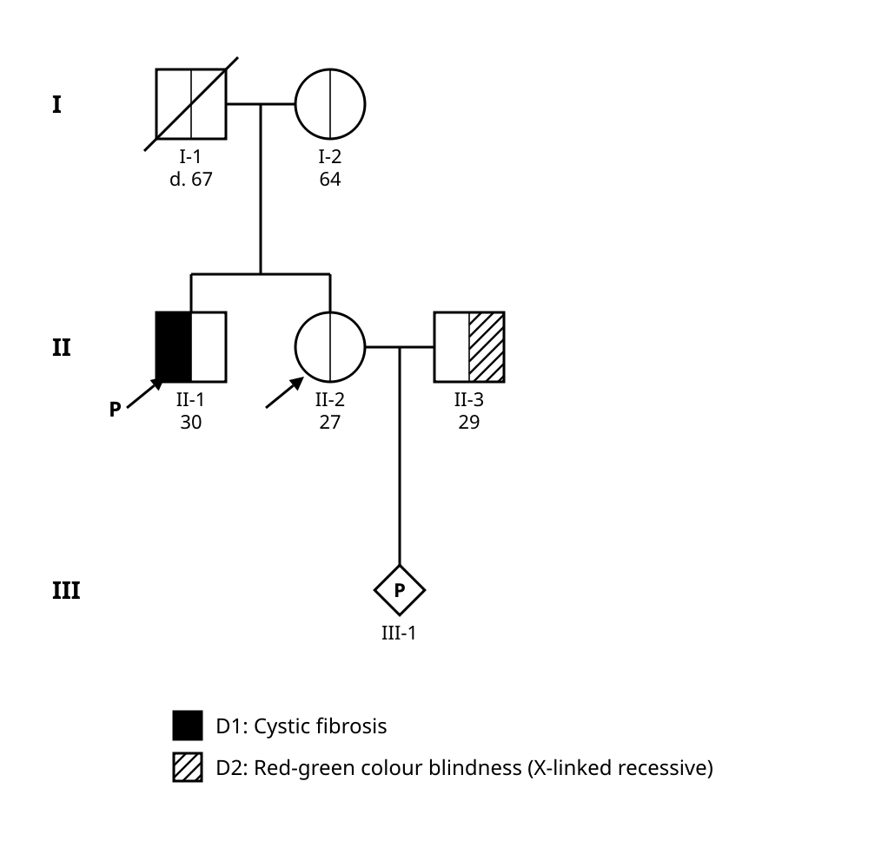
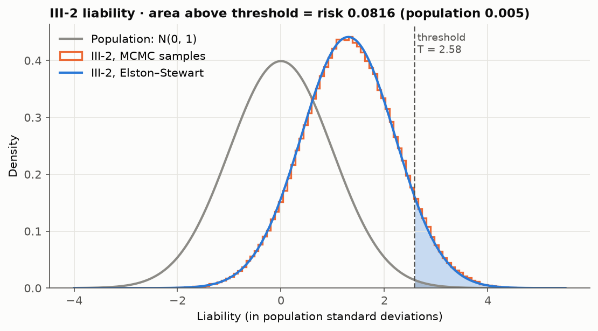

# Summary

Pedigree analysis is taught to every medical and biology student: students draw a family with standard symbols, decide how a disease is inherited, and compute the probability that a relative is a carrier or will be affected. `pedkit` is a Python package that performs these tasks and prints the full working behind each answer. It reads pedigrees in a small tab-separated format (PEDX) that extends the first six columns of the PLINK/LINKAGE PED format [@Purcell2007; @Chang2015], validates them with line-numbered findings, and draws them with the symbols recommended by the National Society of Genetic Counselors [@Bennett2008; @Bennett2022]. For a Mendelian disease it computes the likelihood of seven modes of inheritance by exact peeling [@ElstonStewart1971; @Cannings1978] and by Monte Carlo gene dropping, and builds the prior–conditional–joint–posterior table of genetic counselling for any individual. For a multifactorial disease it computes recurrence risks under Falconer's liability-threshold model [@Falconer1965] by two independent methods. A command-line interface (`pedkit validate|draw|fam|infer|risk|mf`) and a PyQt5 viewer give access to all functions; the core needs only the Python standard library, and the computations use NumPy [@Harris2020] and Matplotlib [@Hunter2007].

# Statement of need

Textbook pedigree problems hide their reasoning in a few fractions. A student told that the healthy sister of a boy with Duchenne muscular dystrophy has a 1/5 carrier risk after two healthy sons rarely sees where the prior of 1/2 and the conditional of 1/4 come from, or what changes when the mutation rate is not zero. Pedigree teaching has also been criticised for presenting inheritance as almost exclusively Mendelian, although most common conditions are multifactorial [@MohammedKamal2026]. Instructors who want to show students the mechanics, or to generate and check new exercises, need a tool that (i) uses the standard symbols, (ii) shows every intermediate quantity rather than a single number, (iii) covers both Mendelian and multifactorial inheritance in the same framework, and (iv) is small enough to install on a student laptop.

`pedkit` is aimed at instructors and students of medical genetics, and at genetic counselling trainees. Its reports list the joint genotype configurations that support each mode of inheritance and the individuals whose observations exclude a mode, the full Bayes table with exact fractions when they exist (2/3, 1/5, 1/153), and, for multifactorial diseases, the Elston–Stewart and MCMC estimates side by side with convergence diagnostics and sensitivity plots for heritability and prevalence. Reports print all results and apply no decision thresholds, so that the interpretation remains a teaching step.

# State of the field

Several tools draw pedigrees. Madeline 2.0 [@Trager2007] and the R packages kinship2 [@Sinnwell2014], Pedixplorer [@LeNezet2025] and ggpedigree [@Garrison2026] produce publication drawings from tabular data; pedigreejs [@Carver2018], QuickPed [@Vigeland2022], genoDraw [@GarciaGiordano2020] and Genetic ME [@Bui2015] provide interactive editors. QuickPed adds relatedness coefficients, and CanRisk [@Carver2021] and Fam3PRO [@Chen2026] compute clinical cancer risks from pedigrees with disease-specific models. None of these combines NSGC drawing with mode-of-inheritance inference, step-by-step Bayes tables and multifactorial recurrence risk for arbitrary teaching examples, and the risk tools are designed to give a clinical answer rather than to expose the computation. `pedkit` fills this gap for teaching; it does not aim to replace clinical risk models or linkage software.

# Software design

The package is organised in layers with optional dependencies. `pedkit.io` reads and writes PEDX; a file read and written back without changes is byte-identical, and unknown columns and metadata are preserved, so that files can be edited by hand and by program alike. `pedkit.validate` reports nine error and four warning rules with line numbers. `pedkit.vis` lays out the pedigree and emits SVG restricted to the SVG 1.2 Tiny profile so that the same output renders in browsers and in Qt.

The genetic computations share one model of transmission for the autosomal, X-linked, Y-linked and mitochondrial modes, with penetrance, phenocopy, new mutation and MZ twins that share one genotype. Three engines evaluate it: generalised Elston–Stewart peeling by variable elimination (`pedkit.peeling`), whose cost depends on the width of the pedigree rather than its size; exhaustive enumeration of genotype assignments for small pedigrees, used as an independent check; and vectorised gene dropping with optional importance sampling, which additionally records genotype configurations and the sources of conflicts. The Bayes risk splits the data into the information above the target (own observations, ancestors, collateral relatives) and below it (descendants and their married-in partners), which reproduces the textbook prior and conditional columns for any pedigree.

The multifactorial module represents the polygenic component by the hypergeometric polygenic model [@Cannings1978; @Fernando1994], peels it with the same variable-elimination code, and removes the finite-locus error by Richardson extrapolation between n and 2n loci. Independently, a Gibbs sampler draws the liabilities from the truncated multivariate normal distribution defined by the kinship matrix [@AlbertChib1993], with a Rao–Blackwellised risk estimate and the Gelman–Rubin diagnostic [@GelmanRubin1992]. Sex-specific prevalences give separate thresholds and reproduce the Carter effect.

The test suite (90 tests) checks results against hand derivations of textbook answers, the agreement of peeling and enumeration to 10⁻¹⁰, Monte Carlo estimates within four standard errors of exact values, and the multifactorial risks against bivariate normal integrals and direct multivariate normal simulation (`docs/validation.md`).

{ width=60% }

{ width=80% }

# Research impact statement

`pedkit` was developed for the medical biology teaching of AUTHOR_AFFILIATION, where it is used to prepare and check pedigree exercises. Its PEDX examples, validation suite and documentation are designed so that instructors can verify each reported number independently, and the format can be exported to PLINK for students moving on to research data. A classroom evaluation is planned.

# AI usage disclosure

Generative AI (Anthropic Claude, used through Claude Code) assisted in writing and translating the source code, tests and documentation under the author's direction. The author specified the methods, reviewed the code, and is responsible for its correctness; all numerical results are checked by the automated tests described above against independent computations.

# Acknowledgements

AUTHOR_ACKNOWLEDGEMENTS

# References
